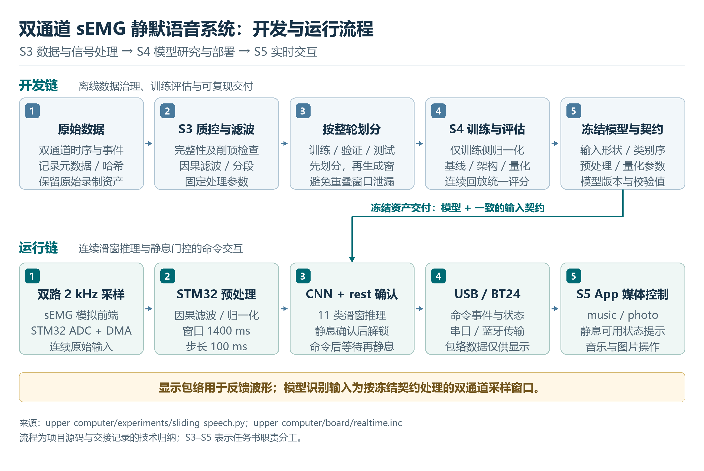
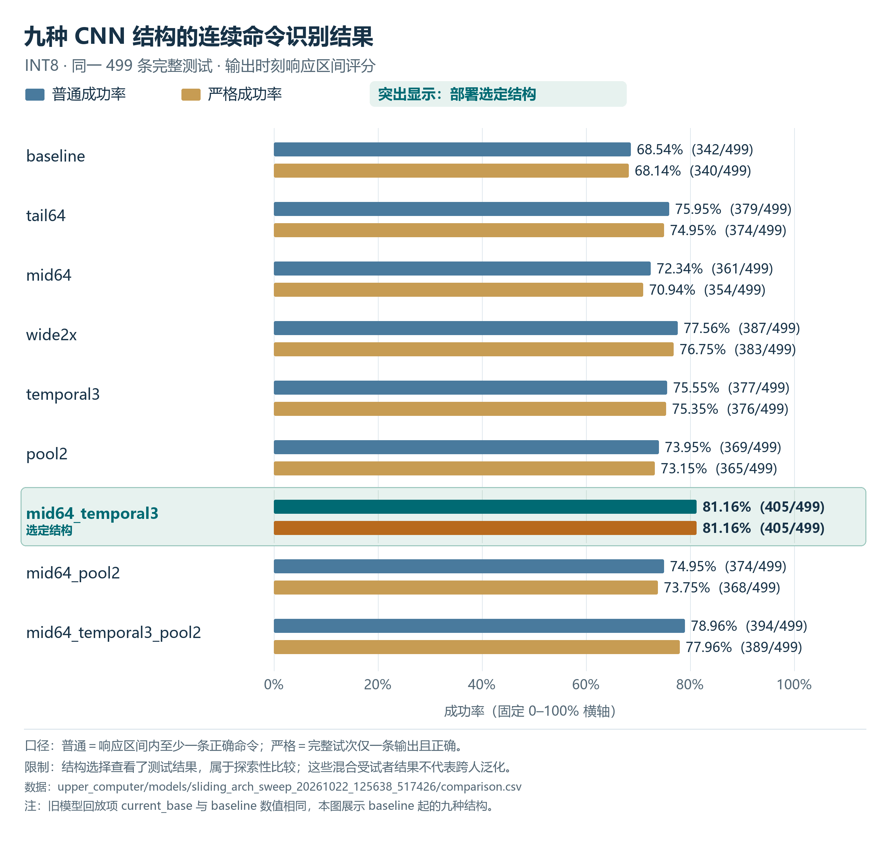

# 1  项目目标与整体结论

## 1.1  研究背景与目标

本项目面向不发声口型的指令交互：利用面部和喉部肌肉在口型变化时产生的表面肌电信号，识别有限词表中的指令，再控制照片浏览和音乐播放。系统的输入是电极采集到的双通道肌电波形，不使用麦克风语音作为在线识别输入；输出是经过静息解锁与连续确认的离散命令，而不是任意句子的连续文字转写。

任务书将项目划分为模拟硬件、固件采集、信号处理、机器学习、应用集成五个相互依赖的层次。S3 的责任是滤波、分段和特征工程，S4 的责任是模型训练、跨人评估、优化与端侧部署，S5 的责任是实时应用、系统联调以及报告协调。三个角色共同承担从可复查数据到可执行交互的技术链路；成员编号 S3、S4、S5 与数据库中的受试者编号 S03、S04、S05 或 S011–S015 不应混用。[R01]

截至 2026 年 10 月 30 日，项目已形成完整的采集与标注工具、传统模型与多类神经网络实验、连续滑窗识别、双版本量化模型、STM32H743 板端推理、USB 串口与 BT24 BLE 监测，以及可操作的本地媒体 App。主要成果是把离线已切段分类逐步推进到具备明确静息状态、模型身份校验和故障拦截的实时系统。现阶段的核心不足是未见人员泛化、重新佩戴后的稳定性、无线长测可靠性和完整真人端到端验收。

## 1.2  主要结论

当前部署结构为五层 mid64_temporal3 CNN，使用两路 2 kHz 输入、1400 ms 历史窗口和 100 ms 步进，输出十个命令加 rest。较早版本 INT8 在 499 条留出动作上得到 405 条正确命令，新版本得到 404 条；对应 81.16% 和 80.96%。这是训练人员已见、按完整轮次留出的连续评估，不能等同于未见人员的跨人准确率，也不能由此宣称更换电极位置后仍保持相同表现。

端侧实测表明该结构能在指定 STM32H743 平台上持续执行，历史记录的单次纯推理和整步处理约为 68 ms，低于 100 ms 滑窗步进。这里的计算时间不包括等待窗口积累、口型动作、静息恢复、连续确认、通信和浏览器执行，因此不能写成完整口型交互延迟低于 200 ms。

BT24 BLE 已完成实际连接、模型身份和短时数据接收验证，20 秒记录无 CRC、序号缺口或板端故障，但较长会话出现序号不连续和断连，另有 UART 故障标志 4 的观测。正确表述应是“已经实现并短时验证无线链路”，而不是“无线长期稳定性已验收通过”。[R02][R03]

## 1.3  任务书目标与实际落实

| 任务书要求或计划 | 实际采用的方案与结果 | 状态判断 |
| --- | --- | --- |
| 五名组员自行采集十词数据 | 当前主数据为 S011–S015 五个记录身份，49 份录制，2500 条 completed 动作，排除削顶后2496条 | 数据工程已完成，不能仅凭记录身份推断实名映射 |
| 20–500 Hz 带通与50 Hz陷波 | 从早期1 kHz方案演进到双路2 kHz与连续因果滤波 | 当前部署已实现 |
| RMS MAV ZCR WL 等特征 | 已形成可配置分段特征和传统LDA基线，另比较ZC SSC | 已实现并开展对照 |
| 比较组内与四训一测跨人表现 | 当前CNN跨人分类40.30%；个人80/20分类92.80%；连续指标分别报告 | 已评估，跨人目标未达成 |
| CNN或LSTM模型开发 | 已比较小CNN、加宽CNN、LSTM、SpeechNet适配、滑窗rest和九种结构 | 已形成系统实验路线 |
| 量化并在ESP32 S3上运行 | 实际选用STM32H743VG，保留FP32和INT8 ONNX及C端实现 | 硬件路线变更，按实物记录 |
| 端侧推理低于200 ms | 指定版本短测计算约68 ms | 计算层面有证据，不等于端到端延迟达标 |
| 五人操作实时演示 | 已有板端、GUI、媒体App与部分真人记录 | 稳定五人完整验收仍待完成 |
| 阶段与最终报告 视频提交 | 当前报告、代码、模型和数据发布可追溯 | 不据此宣称视频或课程最终提交已完成 |

任务书中的每周活动和预算是计划，不作为已经发生的签到、采购、功耗测量或提交记录。电路原理、模拟前端性能、电源实测、PCB与外壳细节属于 S1/S2 及团队硬件报告；本报告只在解释 S3–S5 接口时引用相关已记录参数。[R01]

# 2  共同系统架构与数据基础

## 2.1  从肌电信号到媒体命令

系统由两条协同但不同的流程构成。开发流程将原始采集、标注、质量检查、分段或滑窗构造、训练和离线评估连接起来，并生成冻结模型与输入契约。运行流程在 STM32 上持续完成采样、滤波、标准化、窗口组装、CNN推理和命令确认，再由电脑进行状态监测及媒体执行。训练脚本在电脑上运行，并不意味着线上推理也由电脑完成。

图 1 项目数据开发链与实时运行链。原始波形用于训练和推理；显示包络只提供可视反馈。图中角色标记表示任务书责任接口。

S3 与 S4 的关键接口是数据语义及输入契约：通道顺序、采样率、滤波状态、标准化统计、窗口长度、标签规则和类别顺序必须一致。S4 与 S5 的关键接口是结果语义：滑窗候选、已确认命令、静息解锁、模型身份和故障状态是不同信息。将候选直接用于媒体操作，或将“连接成功”当作“允许执行”，都会破坏系统约束。

## 2.2  数据版本与身份

历史实验曾使用 S04、S05 等较早记录编号及1 kHz数据，后续主训练集使用 S011–S015 的双路2 kHz数据。不同编号、不同采样率和不同采集批次不能仅凭名称相近就合并为同一实验条件。所有历史结果应连同数据根、受试者集合、过滤规则、划分算法和计分口径一起引用。

当前 goodone_plus 包含 S011十份、S012九份、S013十份、S014十份、S015十份录制。S012虽然只有九份，但仍有500条 completed动作，因此不能统一使用“每份50条”来推算总数。四条S014削顶动作被排除，另有一条S015 rejected记录原本不在2500条completed中，不能再重复扣除。

下表为 10 月 27 日部署候选的五人混合训练划分，测试共 499 条。10 月 30 日新增跨人与个人实验采用各自独立划分，见 S4 新增章节，不能混用分母。

| 数据部分 | 有效动作 | 开发训练 | 验证 | 外层测试 | 最终训练池 |
| --- | ---: | ---: | ---: | ---: | ---: |
| S011 | 500 | 300 | 100 | 100 | 400 |
| S012 | 500 | 310 | 90 | 100 | 400 |
| S013 | 500 | 300 | 100 | 100 | 400 |
| S014 | 496 | 297 | 100 | 99 | 397 |
| S015 | 500 | 300 | 100 | 100 | 400 |
| 合计 | 2496 | 1507 | 490 | 499 | 1997 |

外层按完整十词轮次进行80/20划分，种子为20260924；外层训练池再按整轮划出验证，种子为20261010。最终训练池合并开发训练与验证，但不加入外层测试。重叠窗口必须在既定分区内生成，不能先生成大量相关滑窗再随机分配到训练和测试。

较早部署版本使用S013/session_001完整十组；新部署版本使用goodone_plus/s013，其中四组已替换为session_003来源的新录制。两版本各196个核心输入文件已与历史哈希核对一致。新旧S013测试各100条的交集为零，其他四人的399条测试一致；总体成绩差0.20个百分点不能被解释为同一测试集上的确定退步。[R04][R05]

## 2.3  工程演进的主要节点

| 时间 | 主要变化 | 对S3至S5工作的影响 |
| --- | --- | --- |
| 9月24日至10月7日 | 上位机迁移 动态词表 十词协议与数据组织 | 建立采集标注和特征模型接口 |
| 10月10日 | 双通道 可配置特征 活动检测 小CNN | 从单一特征基线转向数据与模型联合诊断 |
| 10月13日至14日 | 双人CNN和LSTM 四人跨人评估 多人混合训练 | 识别出混合留出与真正跨人的性能差异 |
| 10月16日 | 每路2 kHz与20–500 Hz处理 | 训练 输入契约和固件需要同步升级 |
| 10月21日 | 加宽CNN 自动分段重训 SpeechNet 量化修正 | 暴露检测覆盖和量化动态范围瓶颈 |
| 10月22日至26日 | rest滑窗 架构对照 端侧部署 媒体App | 建立持续识别和可执行命令闭环 |
| 10月27日至28日 | S013四组替换 新版重训 双波特率 BT24 BLE | 新旧模型独立保留，新增无线链路证据 |
| 10月29日 | 静息状态框 场景过滤开关 数据发布 | 改善可见性与可追溯性，不改变模型判断 |

这些日期来自工程交接，不替代任务书中的逐周到场或个人工时记录。各阶段失败结果与重新选择的理由在后续三个责任章节分别展开。

10 月 29 日新增当前数据的跨人 LDA 与个体适应研究：零校准基线为 446/2496（17.87%）；固定每人 50 条校准重复 40 次加其他四人为 915/2246（40.74%）；每录制每词 K=3 按人汇总、重复 10 次加其他四人为 686/1026（66.86%）。两种适应方案的校准量和测试集不同，详见 S4 章节；这些结果均为离线片段分类，未进行板端验收。[R06，R07]

10 月 30 日进一步完成当前架构五折跨人与五个独立个人模型实验。跨人 FP32 十词分类 1006/2496（40.30%），连续正确命令率 37.94%；个人整轮 80/20 十词分类 464/500（92.80%），连续正确命令率 80.80%。前者整个人未见、无个人校准，后者同录制内整轮留出，两者不构成同测试集的直接消融比较。两组均为离线连续回放，未部署新权重。详见 S4 新增实验章节。[R08，R09]

# 3  S3 信号处理与特征工程

## 3.1  职责与实际成果

任务书将 S3 定位为信号处理与特征工程负责人，要求建立滤波、分段和特征提取流程，并与 S4 联合完成数据标注及模型输入设计。实际工作逐步从单通道离线试次处理，扩展为双通道完整采样、可配置手工特征、无提示活动检测、连续滑窗与静息类别，以及与 STM32 部署一致的预处理契约。

S3 的核心成果不是某一组滤波参数，而是建立了从原始字节、设备样本时钟和试次标记，到可复核的分类输入之间的完整转换关系。现有结果表明，传输无误、动作时机合规、特征可分和连续命令可用分别需要验证；任何一项通过都不能代替其余三项。

[R01，R10，R11]

## 3.2  从单通道到双通道完整采样

早期系统只有一个物理 ADC 通道，界面中的原始、带通和包络三条曲线是同一信号的三种表示，不能写成三通道肌电。2026 年 10 月 10 日的 v0.5.0 才引入 PA7 上的 CH0 和 PC5 上的 CH1，适配喉咙与脸颊两个位置。两路通过同一 ADC 顺序扫描，共用采样点序号；这能建立明确的成对关系，但并不是经测量证明的严格同时采样。

协议 v2 将一个采样点定义为一对 CH0/CH1 数值，而非单个通道值。每帧保存 20 对交错的 16 位 ADC 样本，DATA 的 first/count 以时间点计。录制保持两路原始数值和共同序号，metadata 另记录用户启用哪些通道及各通道位置。未选择的物理通道仍被保存，但不应作为有效训练通道；缺少所需通道时拒绝提取，不用零填充伪造。各通道独立滤波、独立生成质量统计，最后按固定顺序组合。

这一改动将位置差异带来的信息保留下来，同时使实验必须核对通道位置、选择状态和采样率。把 CH1 数据重命名为 CH0，或仅按 CSV 中有几列推断通道数，都会破坏模型输入含义。当前训练与导出保存物理通道编号和逐通道信号指纹，减少复制文件、选择不同通道时的误用。

[R12，R13，R11]

## 3.3  采样率与频带升级

早期每路 1000 Hz，对应显示及基线处理频带 20–400 Hz。任务书提出 20–500 Hz，而 1000 Hz 采样的奈奎斯特边界正好为 500 Hz，不能只把数字滤波器参数从 400 改成 500。2026 年 10 月 16 日的 v0.6.0 因此同时升级采样、串口、元数据、包络长度和模型时间参数，使每路采样率达到 2000 Hz，原始采集 UART 使用 230400、8N1。最新监测模式可使用 115200，是因为发送的是推理结果和包络，不能据此推断完整原始波形采集也可直接改用 115200。

上位机以设备 INFO 报告的采样率为准，支持 1000/2000 Hz，在连接中参数变化时拒绝继续处理。2 kHz 条件下，1 s 准备预热是 2000 点，150 ms 裁边是 300 点，200 ms 显示包络是 400 点。保持物理时长而不是沿用旧样本数，避免升级之后所有窗口被无意缩短一半。旧版 1 kHz 活动识别和静息节律工具对 2 kHz 数据明确拒绝或停用，没有把旧算法时间刻度直接套用到新数据。

同日采集固件烧录后的约 12 s 检查收到 1207 帧、24140 对样本；两个设备标记相差 20060 个样本和 10030 ms，计算得到每路 2000 Hz。该轮 CRC、缺样、序号跳变和故障计数均为零，但 CH1 出现 5 个触底样本。它验证了数字采样与传输链路，不验证模拟前端带宽、绝对时钟精度、佩戴质量或识别准确率。

[R14，R15，R11]

## 3.4  滤波与显示包络

当前部署路径将无符号 16 位 ADC 先减去 32768，再执行 20–500 Hz 带通和 50 Hz 陷波，陷波 Q 为 30。Python 中以四阶 Butterworth 原型设计带通，变换后的带通为八阶、四个二阶节，再加一个陷波二阶节，合计五节 SOS。旧 1 kHz 默认路径使用 20–400 Hz；另外保留 20–450 Hz 及增加 100/200 Hz 陷波的历史实验变体，模型必须携带其真实使用的滤波配置。

离线 LDA 使用单向因果 sosfilt，在每条试次准备段起点按首个中心化样本初始化 SOS 状态，然后经过准备段预热，再提取动作区间。这样不会让该试次之后的休息或后续试次影响当前特征。连续回放与板端则保持滤波状态跨帧更新；同一录制换一种主机分块方式，不应改变滤波结果。两种处理方式边界不同，报告必须明确是逐试次初始化还是连续滤波，不能简单写成同一操作。

主分类路径没有用双向零相位滤波代替实时滤波。零相位算法需要使用窗口后面的样本，不能把它的离线效果直接当成在线等价结果。后述早期节律观察支路确有 sosfiltfilt，但它只分析已取得的静息窗口，与分类输入分开。

显示包络是滤波信号绝对值的 200 ms 移动平均，用于观察两路肌肉活动强弱。它不是 CNN 输入，也不是活动检测器的 60 ms RMS。2026 年 10 月 10 日界面改为 CH0、CH1 和叠加三幅包络后，底层仍保存全程原始 ADC；更改坐标范围或显示方式不会重新定义训练信号。当前监测界面显示最近 5 s、固定 0–500 counts 的包络，超量程给出提示，不能通过自动缩放把漂移或削顶掩盖掉。

[R15，R11，R16，R17，R02]

## 3.5  标签与试次边界

离线处理依据 events.jsonl 的 prepare/action/rest 事件及其设备 marker_ack，使用设备样本序号确定边界，不直接把电脑时间戳换算成 ADC 位置。extract_recording 要求阶段完整且唯一、试次编号不重复、prepare < action < rest、边界位于数据范围内、准备段至少 1 s，并且 CSV 样本序号连续。缺样数据不能通过删除缺口、压缩时间后继续训练；录制正在变化、ACK 重复、动作区间重叠等情况也会被阻止。

在准备和动作的联合区间内，启用通道出现 ADC≤1 或 ADC≥65534 即拒绝该试次。动作区间首尾各裁 150 ms，降低提示转换和边缘扰动的影响；裁后要求至少 400 ms，每个特征子段至少 50 ms。需要注意，当前提示切段规则不会因随后休息期削顶自动拒绝该动作，因此数据质检仍要查看完整记录，而非只读“接受多少条”。

屏幕提示是监督标签的时间代理，不是经过人工逐样本核对的真实肌肉活动起止。早期 S01 某组虽然 50 条全部通过程序检查，但用户确认在准备期看到词就开始动作，44/50 次最大包络峰在动作标记之前。处理程序遵循标签仍可能切错真实动作，说明软件合法性和实验依从性必须分别核查。标准流程调整后的另一组有 48/50 次峰位于动作期，组内 LDA 从前述组的 10% 变为 24%；这属于诊断性观察，不能当作独立控制实验或因果证明。

[R11，R18]

## 3.6  可配置手工特征

最初每通道分四个时间段，每段提取 log RMS 和 log 平均绝对相邻差，共八维。后续将分段数开放为 1–12，并允许选择特征类型。给定裁剪后某子段 x，共 N 点，主要定义如下。

| 特征 | 本项目实现 | 解释及限制 |
| --- | --- | --- |
| RMS | sqrt(mean(x²)) | 能量幅度的统计表示 |
| MAV | mean(abs(x)) | 平均绝对幅度 |
| WL | sum(abs(diff(x))) | 与变化速度和长度均有关 |
| 平均绝对相邻差 | mean(abs(diff(x))) | 是 WL 的按相邻点对数归一化形式，不能与原始 WL 混写 |
| log 幅度特征 | log(上述 RMS、MAV 或平均绝对相邻差 + 1e-8) | 对数压缩幅度范围，避免零值取对数 |
| ZC | 相邻点严格异号的次数 | 零幅度阈值，精确零点不计，小噪声仍可能贡献计数 |
| ZCR | ZC/(N−1) | 无量纲比例，与 ZC 次数不同 |
| SSC | 相邻一阶差分严格异号的次数 | 平坦斜率不计，不取对数 |
| MNF | 去均值后加 Hann 窗的带内功率谱质心 | 1 kHz 时统计 20–400 Hz，2 kHz 时统计 20–500 Hz |

双通道采用相同分段规则，逐路提取后拼接。维数等于通道数×时间段数×特征数，例如双通道、六段、四项特征得到 48 维。默认八维方案、六段四特征方案和 RMS/MAV/ZCR/WL 方案是不同的特征定义，不能只因都是“48 维”就认为可互换。

模型保存分段数、特征名、排列顺序和通道信息，加载测试按模型配置提取，而非读取界面当前勾选项。标准化只在训练侧拟合，随后固定用于验证和测试；指纹基于原始信号及动作偏移计算，改变特征配置不能绕过重复样本检测。早期模型 schema 的兼容逻辑保留了原四段两特征及 CH0 含义。

[R11，R19，R20]

## 3.7  特征与频带实验的有效结论

更早的四词探索已说明“滤得更干净”不等于“更容易分类”：2026 年 9 月 24 日重点录制在额外增加 100/200 Hz 陷波后，背景幅度下降、动作/休息幅度比提高，但内部分类由 31/40 降为 27/40。主显示因此没有未经评估地堆叠更多陷波，而是保留原始数据和独立配置供对照。该结果只支持处理方案需要由任务指标检验，不证明这些频率必然属于有用肌电或无用噪声。

同一份 S05 的 100 条旧 1 kHz 录制，按留一整轮的十折评估，四段两特征为 27/100、六段两特征为 26/100、六段四特征为 30/100。增维只多正确三次，且该录制已反复查看，不能据此宣称泛化提高。

2026 年 10 月 14 日的四人 LOSO 对照保持 1998 条动作及各折划分不变，仅将 20–400 Hz 改为 20–450 Hz，合并正确数由 413 增为 418，准确率由 20.67% 变为 20.92%。恢复原频带后，将 log 平均绝对相邻差、log MAV、ZC、SSC 改为 RMS、MAV、ZCR、WL，正确数降至 391/1998，即 19.57%。因此，在这批数据上扩大带宽或换用任务书列举的经典四特征，都没有解决跨人低准确率。该实验使用 S01/S02/S04/S05 四人，排除了另一位受试者，不等同于任务书要求的完整五人四训一测。

S3 可据此报告已经完成可比较的特征对照，而不能把“增加了特征选项”表述成“识别率必然提升”。特征的有效性必须连同数据版本、受试者、评估方式和固定划分一起说明。

[R10，R19，R21，R22]

## 3.8  数据质量与身份审计

项目建立的质量审计包含三层。传输层检查原始 transport.bin 解码结果与 samples.csv 的序号和 ADC 数值、CRC、故障和标记 ACK；波形层检查端点削顶、平直、漂移、准备/动作/休息各阶段幅度和峰位置；实验层结合动作条件、贴片位置、出声与否和操作者更正解释记录。原始文件分析前后记录 SHA256，使处理过程可追溯。

动作/休息 RMS 比可以描述幅度差，但不是独立测量的 SNR，更不能把某个经验比值当成通用质量门槛。端点削顶检测也不能排除发生在 ADC 满量程以内的模拟前端饱和。早期某份记录 50 条只有 18 条通过检查，多个词只剩一条，因此没有强行报告十词分类分数。这比用残缺数据补齐人数后报告一个好看的平均值更可靠。

身份更正同样影响 S3 到 S4 的输入正确性。10 月 7 日两份 S03/S04 标签曾填反，早期只在分析说明中保留映射，不能假定 GUI 已自动读取这些说明。另有 10 月 10 日一份误标 S05 的录制在用户确认后移动到 S02/session_005，并保存更正前 metadata 和文件哈希；依赖旧身份的模型报告保留历史并标注失效。成员角色 S3 不等于受试者 S03，最终五人数据 S011–S015 也不能无证据映射到五位成员实名。

当前 goodone_plus 的 49 份录制共有 2500 条 completed 动作，按既定规则排除 S014 四条准备/动作期削顶后为 2496 条有效动作。另有 S015 一条 rejected 记录不在 2500 条 completed 内，不能再次扣除得到 2495。S015 子集和 S013 四组替换参考过已有 LDA 结果，这不是完全不看标签的质量筛选，也不是独立盲测数据。

[R18，R16，R02，R23]

## 3.9  从提示分段到无提示活动检测

早期 1 kHz 活动 LDA 采用 20 ms 步长和 100 ms 尾随 RMS，使用独立模型格式，阻止将按提示分段训练的旧 LDA 直接装入活动识别窗口。该分支的最大概率 0.6、前两类差 0.2 只是启发式接受门槛，并不是已验证的未知动作拒识器。10 月 10 日修正“把结束确认等待算入最长活动时长”的错误后，S05 的后两轮 20 个提示词中有 16 次唯一匹配候选，但仅 1 次被接受且分类正确，另有 5 次未匹配候选被接受。它明确暴露了检测、分类和拒识的共同问题，不能拿全段含训练数据的回放接受次数作为准确率。完整样本在可丢弃预览队列之前交给识别器，识别异常停止识别而不中断原始保存，使实验性算法不会破坏数据采集。

提示切段能回答“已知这个区间是一条动作时，能否识别词语”，但真实使用时不知道动作起点和终点。为此先建立旧 1 kHz 的活动切段 LDA，再另建 2 kHz 的 activity_cnn 前端。后者每 20 ms 更新一次过去 60 ms 的双通道 RMS，检测器只接收波形、RMS 和削顶信息，不读取提示词或目标标签。初始 5 s 静息用于每通道校准，跳过前 500 ms 和削顶后 200 ms，要求至少 3 s 干净数据；起止阈值结合中位数、MAD、幅度比和下限，形成滞回以降低抖动。

2026 年 10 月 21 日在验证侧选择的配置为 onset 比例 4、offset 比例 2.2、启动持续 60 ms、结束等待 320 ms、重新触发静息 500 ms，候选前后各保留 150 ms，活动有效时长 200–2700 ms。任一路超过阈值可触发，两路都安静才释放；削顶取消当前候选。超长片段不强行截断，文件末尾未自然结束的活动不强行补输出。这里的实验选中值与源码 GateConfig 默认值不完全相同，应以该实验保存的 selected.json 为准。

固定检测器在测试 499 条动作中给出 437 条可匹配候选，覆盖率 87.58%，其余 62 条即使后级分类完全正确也无法恢复。原提示切片训练 CNN 改接自动检测片段后，INT8 至少一次正确为 274/499，即 54.91%；同一连续滤波信号改用原提示切片则仍为 395/499，即 79.16%。自动片段中位长度约 1.36 s，原训练通常约 1.7 s，而且位置不同。这支持优先检查分段分布差异，而非直接将下降归咎于算力不足。该成绩是当时基于候选匹配的旧口径，后续统一按实际输出时刻评分后，不能直接混列为同一种准确率。

[R24，R25，R26，R27，R28]

## 3.10  连续滑窗与静息标签

最终实时路线不再等待 RMS 检测器切完一个词，而是每 100 ms 读取过去 1400 ms 的双通道滤波波形，即 2800 点/路，并将 rest 与十个动作词共同建模。窗口时刻由设备样本栅格决定，不跟随提示时刻移动。训练标签仍使用提示作为代理，但采取保护区：动作覆盖窗口至少 75%，且窗末已超过动作开始 150 ms、未超出动作结束，才赋动作词；静息窗必须完整处于受保护的准备或休息段。准备段前后分别留 200 ms 保护，动作后至少等待 300 ms，窗末距上下文末至少 100 ms。

含糊过渡窗不强行贴成 rest，也不进入监督损失；连续回放仍必须处理它们，不能只评估“容易贴标签”的窗口。源码中的 300、400、600、200 等阈值是样本数，要除以 2000 才得到秒。重叠窗口有高度相关性，新增几千个窗口不等于新增几千次独立口型。

划分先在完整轮次层完成，再生成窗口；训练、验证、测试之间不跨界取窗。连续回放在留出区间起点重建解码器，区间内部不在每个提示动作边界重置，否则会把真实使用时不可获得的信息带入评分。模型输出还需连续 rest 解锁和词语确认，S3 的窗口与标签设计因而直接影响 S4 模型以及 S5 的可接受命令状态。

[R29，R30，R02]

## 3.11  模型输入一致性与交付接口

提示分段 CNN 的历史输入通过准备段预热、150 ms 裁边后右侧补零至指定容量，不进行时间重采样；归一化只使用训练侧真实非填充样本，归一化后填充区仍为零。连续滑窗模型则使用固定实际时间长度，训练侧统计来自连续上下文，每通道固定均值和标准差；验证、测试分区中的采样点不参与开发阶段归一化拟合。混合实验中，同一人员仍可能出现在不同整轮分区。最终从训练加验证重训时重新计算对应训练池统计，外层测试仍保持隔离。

部署交付需冻结通道次序、采样率、ADC 中心值、五节 SOS、状态初始化、归一化统计、窗口长度、步长和类别顺序，而不只是交付权重文件。当前 Python、ONNX 和板端都围绕这一契约实现；显示包络不能替换滤波波形，实时路径也不能改成零相位滤波。S3 向 S4 交付可追踪的波形/特征及试次身份，向 S5 交付可显示的质量与包络解释，并与 S2 共同约束设备样本时钟及中断数据的处理。

[R31，R30，R32，R17]

## 3.12  辅助探索与尚未完成的验证

早期界面另有独立的“疑似心搏节律”观察功能，分析 10 s 连续 1 kHz 静息窗口，采用 5–30 Hz 支路、60 ms 能量包络和峰间隔/形态筛选，并在断流或数据过期时重置。这只是波形重复节律的探索，不是 ECG、经验证的心率，也不是电极接触合格证明；缺少同步 ECG/PPG 验证，不能列为已完成的生理测量成果。

S3 当前仍需补充真实肌肉动作边界标注、跨佩戴日与重新贴片条件下的数据、吞咽/转头/走动等非命令负例，以及更完整的模拟前端质量证据。已有后续日志表明，有些命令有高置信度正确候选却因未静息解锁而无响应；这不能靠换一个幅度特征单独解决，也不宜直接取消解锁保护。后续应分别统计分段遗漏、词混淆、静息错误和状态机阻止，再用独立新数据评估调整。

本章节的阶段性结论是：已形成可保存原始证据、可重现预处理、可比较特征、可进行无提示连续推理的处理链；任务书中的频带、特征及分段工作已得到实质实现，但独立跨佩戴泛化、自然负例误触发率和真实口型到命令的端到端延迟仍需进一步验证。

[R33，R14，R02]

# 4  S4 机器学习研究与端侧模型优化

## 4.1  职责与研究目标

按照任务书，S4 负责模型训练、跨受试者验证、模型优化与边缘部署，并与 S3 对齐输入信号和特征定义，与 S2 对齐采样、存储与计算约束，与 S5 对齐实际命令的输出形式。

机器学习部分的目标逐步从“已切好的一段口型属于哪个词”，扩展为“连续肌电流中何时应输出哪个命令、何时应保持静息”。研究因此包含传统特征分类、波形深度学习、跨人泛化、自动分段、滑动窗口静息类、架构对照、量化及端侧验证。任务书提出组内准确率高于 70%、跨人准确率高于 50% 和端侧推理低于 200 ms。已见人员混合模型的留出动作结果超过 70%，但现有跨人结果没有达到 50%；计算耗时达标也不等于用户开始动作到应用响应的总延迟低于 200 ms。

[R01，R02]

## 4.2  数据版本与公平评估基础

本项目存在多个阶段的数据，必须以采样率、人员集合、动作边界和划分方式识别实验，不能把不同阶段最好的数字拼成一个系统指标。早期 goodone 使用 1 kHz 数据及 S01 至 S05 编号；后期 goodone_plus 使用双通道 2 kHz 数据及 S011 至 S015 编号。这些是实验数据标识，不应与任务书成员 S3、S4、S5 的职责编号混淆。

当前五人主数据集有 49 份录制，各人的份数为 10、9、10、10、10。每人有 500 条 completed 动作，总计 2500 条；S014 四条准备或动作期存在 ADC 削顶，按既有质量规则排除，剩余 2496 条。S015 另有一条 rejected 记录本来不属于上述 2500 条，不应再重复扣除。S012 虽只有九份录制，仍有 500 条动作，不能假定所有文件夹都固定包含 50 条。

开发训练、验证、测试分别为 1507、490、499 条；最终训练池为 1997 条。逐人划分见第 2 章数据表。

后期主实验按每份录制的完整十词轮次做外层 80/20 划分，种子为 20260924；训练侧内部再按整轮留验证，种子为 20261010。开发阶段用于选择模型，选定后从头用训练和验证合并的 1997 条动作重训，最后评估固定测试集。一个动作衍生出的重叠窗不得跨训练、验证和测试；连续区间边界也不能让训练侧解码历史进入测试区间。

标准化参数只从对应训练侧拟合；PTQ 校准只用训练侧窗口；测试人的统计量不用于 LOSO。代码还保存动作指纹、输入文件 SHA256、逐试次划分、源码快照及分阶段封存清单，并检查重载模型能否重现预测。它们解决的是实验可追溯性和明显的数据泄漏风险，不能消除研究者反复查看同一测试集带来的选择偏差。S015 和后来 S013 的部分数据整理参考了已观察的 LDA 成绩，因此当前结果应定位为探索性开发评估，而非全新盲测。

[R34，R35，R36，R04]

## 4.3  传统模型与早期神经网络基线

传统基线采用 StandardScaler 与收缩 LDA，求解器为 lsqr，shrinkage 为 auto。后期常用输入是每通道六个时间段、每段四个特征，共 48 维。主线 legacy 特征为 log_mean_abs_diff、log_mav、zc_count_zero、ssc_count_zero；不能把所有 LDA 结果统一改写成任务书示例中的 RMS、MAV、ZCR、WL。后者确实单独实现并做过对照，但结果没有改善跨人表现。

最初小型 CNN 的作用是判断端到端波形特征是否优于手工特征。网络输入双通道 2048 点，三层一维卷积通道为 16、32、64，卷积核为 15、9、7，包含 BatchNorm、ReLU、池化、Dropout 和十分类头，共 23,498 个参数。它与 LDA 共用因果滤波、准备期预热、动作首尾各裁 150 ms 的输入范围，短动作右补零，不做时间拉伸。归一化只拟合有效训练波形；训练增强使用双路共同的时间平移和各通道增益扰动。

| 早期提示切段实验 | 相同测试集上的 LDA | 相同测试集上的 CNN | 说明 |
| --- | --- | --- | --- |
| 10 月 10 日首次十一份录制基线 | 41/110，37.27% | 54/110，49.09% | S02、S03、S05 混合，固定 110 条测试 |
| S05 session_014 | 77/99，77.78% | 85/99，85.86% | 单人、同 session，固定 99 条测试 |
| S04 与 S05 双人混合 | 115/200，57.50% | 168/200，84.00% | 两人各 100 条测试 |
| 旧 goodone 四人混合 | 203/399，50.88% | 323/399，80.95% | S01、S02、S04、S05 均参与训练 |
| 旧 goodone 五人混合 | 215/499，43.09% | 377/499，75.55% | 加入 S03，仍为已见人员留出动作 |

表中每行内可以作同测试成员比较，跨行不能直接解释为单一算法改进。双人 CNN 的总体宏 F1 为 0.8379，净增加 53 条正确，但 previous 一词由 LDA 的 16/20 降到 13/20，说明总体提升不是所有类别都改善。单人 S05 的 CNN 也存在 close 低于 LDA 的情况。早期网络在电脑上前向传播约 0.229 ms 的中位耗时仅属于该电脑单样本网络计算，不能代替 MCU 或总交互时延。

双人 LSTM 对照严格沿用 CNN 的 998 条有效动作和 608/190/200 开发划分。输入将双路 2048 点按每 16 点无损分帧为 128×32，经过单层单向 LSTM、隐藏维 64、六段时间池化及分类头，共 28,938 个参数。最终 162/200 为 81.00%，宏 F1 为 0.8105，较 CNN 少对六条；其中 S04 为 71%，S05 为 91%，两人的变化方向相反。该结果支持继续以此 CNN 作为候选，但不证明 LSTM 方法普遍较差，也不能按测试结果事后为每人选择表现最好的模型并声称组合模型获得独立测试收益。

[R37，R38，R39，R40，R41，R42]

## 4.4  跨受试者验证与未达成的泛化目标

多人混合训练不等于跨受试者泛化。项目专门实施了留一人测试：每折训练时完全排除目标人，由其他人的训练侧拟合标准化、训练分类器和完成验证选择。早期四人试验只使用 S01、S02、S04、S05，因此是三人训练、一人测试的四折 LOSO，不是任务书要求的完整五人四训一测。

| 旧 goodone 四人 LOSO 的测试人 | LDA 正确数 | LDA 准确率 | 小型 CNN 正确数 | CNN 准确率 |
| --- | ---: | ---: | ---: | ---: |
| S01 | 136/500 | 27.20% | 60/500 | 12.00% |
| S02 | 70/500 | 14.00% | 83/500 | 16.60% |
| S04 | 75/500 | 15.00% | 66/500 | 13.20% |
| S05 | 132/498 | 26.51% | 122/498 | 24.50% |
| 合并 | 413/1998 | 20.67% | 331/1998 | 16.57% |

CNN 的源人员内部验证准确率约 82.76% 至 87.96%，但未见人员测试显著较低，直接说明内部验证不能替代跨人测试。仅 S02 的 CNN 高于 LDA；四人总体少对 82 条。任务书跨人超过 50% 的目标在该阶段没有达到。

针对这一问题，项目还做了受控的 LDA 变化实验。保持同样的 39 份录制和 1998 个有效动作，仅将 20–400 Hz 改为 20–450 Hz，合并成绩从 413/1998 提升到 418/1998，即约 20.92%，只有五条净改善。恢复 20–400 Hz 并改用 RMS、MAV、ZCR、WL，结果为 391/1998，即 19.57%，低于 legacy 特征。这些结果不支持仅依靠稍宽频带或替换一套常见时域特征就能解决跨人分布差异。

10 月 26 日在 2 kHz goodone_plus 上补充了完整五折 LDA LOSO，每折四人训练、一人测试。S011 至 S015 分别为 107/500、46/500、83/500、78/496、109/500；准确率为 21.40%、9.20%、16.60%、15.73%、21.80%。总体 423/2496 为 16.95%，整体宏 F1 约 0.1645。逐条测试身份、训练人隔离、标准化与模型重载复算均有审计。

该五人 LDA 结果对应 S013 四组替换前的数据。当时尚未完成当前五层 CNN 的五折 LOSO；10 月 30 日已在替换后的数据上补充该实验，详见本章新增章节。16.95% 仍是旧数据 LDA 的成绩，约 81% 的混合留出成绩也不能当作跨人目标达标。跨佩戴、跨日和未见人是不同问题，应分别组织测试。

[R43，R44，R21，R22，R45]

## 4.5  从已知边界分类走向连续识别

提示切段使用了实验中已知的动作起止；实际控制媒体时没有这一先验。若仅展示裁好动作后的分类准确率，就不能解释系统在静息、动作开始、动作结束及连续命令之间的行为。因此研究先采用活动检测器产生候选片段，再交给 CNN，并进一步比较使用提示片段训练和使用自动检测片段训练的差异。

2 kHz 五人提示切段模型使用 6144 点容量，容纳最长约 3.072 s 的动作，短片段右补零。三层 H7SmallCNN 的 16/32/64 版本在 499 条测试上 FP32 为 380/499，INT8 为 381/499；32/64/128 加宽版本 FP32 为 412/499，INT8 为 395/499。加宽提高了浮点切段分类，却在量化后损失 17 条，表明参数更多不保证部署后更好。

| 固定活动检测器后的连续方案 | FP32 正确命令 | INT8 正确命令 | INT8 严格成功 |
| --- | ---: | ---: | ---: |
| 原提示片段训练的加宽 CNN | 283/499，56.71% | 274/499，54.91% | 257/499，51.50% |
| 自动分段片段重训加宽 CNN | 326/499，65.33% | 306/499，61.32% | 292/499，58.52% |
| 双通道适配 SpeechNet | 334/499，66.93% | 340/499，68.14% | 318/499，63.73% |

这张表采用当时的候选片段重叠匹配评分。共同的活动检测器只覆盖 437/499 条，漏掉 62 条；即使后端分类完全正确，也不能挽回未被检测到的动作。使用自动检测片段训练有助于减少训练和使用时的片段分布不一致，但没有自动解决检测覆盖率和静息误触发。

SpeechNet 并非照搬原论文实验。项目参考本地作者代码，适配双电极输入；时间卷积核比较 4/16/8 与 16/64/32，空间融合核调整为 2×1 与 1×1，采用五层 Conv、BN、ReLU、MaxPool 和末端汇总分类。选中 time_scaled、种子 20261012、57 轮、99.9 百分位校准。时间核放大是候选结构设计，不是将采样波形拉伸四倍；其多通道来源、适配代码与许可保存在 third_party。

[R46，R47，R48，R49，R50]

## 4.6  滑动窗口与静息类

后续方案取消“必须先检测出一个完整片段”的前置条件，以固定时钟每 100 ms 取过去 1400 ms 波形，直接输出十个词和 rest 共十一类。rest 代表静息或无命令，并非媒体控制词。最初还比较了 800 ms 和 1400 ms；根据验证选择 1400 ms、种子 20261011、42 轮和 99.99 百分位校准，形成第一轮滑窗基模。

窗口训练标签使用提示阶段作代理。词窗口至少有 75% 时长落在动作区，结束时刻在 action 后至少 150 ms 且不晚于动作结束；纯准备或静息窗口有保护间隔。含糊过渡窗口不参与监督损失，但连续测试仍推理它们，并让其影响状态机。不能在测试时删除这些难窗口，否则评价不再代表连续使用。

为避免静息样本数量占优，每轮按十一类各抽 400 个窗口，共 4400 窗；类内先平衡人员，再选试次和窗口。训练使用有放回抽样，验证使用固定且无重复的均衡子集，PTQ 使用训练侧代表窗。4400 不是每轮新增的独立动作数量，不能据此夸大样本规模。输入归一化使用训练侧连续唯一采样点，不用重叠采样重复加权测试统计。

评分同时从“候选片段是否重叠”改为“真正输出命令的时刻是否符合响应区间”。在统一输出时刻评分下，旧提示 CNN、自动分段 CNN、gated SpeechNet 的 INT8 正确率分别为 233/499（46.69%）、255/499（51.10%）、290/499（58.12%）；滑窗基模 INT8 为 342/499（68.54%），严格成功 68.14%。提示静息输出从旧方案约 5.895 次/分钟降为基模约 0.548 次/分钟。旧 SpeechNet 的 68.14% 和统一评分的 58.12% 不代表同模型退化，而是评分口径不同；不同方案连续运行边界也并不完全相同，不能将全部增益单独归因于神经网络架构。

[R29，R30，R51，R52]

## 4.7  最终五层 CNN 的结构与训练配方

当前两版部署模型都采用 mid64_temporal3。训练输入为 B×2×2800，ONNX 外部输入为 1×2×1×2800，内部转为 1×1×2×2800。两电极位于空间高度维，第一卷积层输入特征通道是 1；不能把两电极数与卷积输出通道数混为一谈。

| 模块 | 卷积输入输出通道 | 卷积核 | 最大池化 | 输出形状 C×H×T |
| --- | --- | --- | --- | --- |
| 第一块 | 1→8 | 1×16 | 1×8 | 8×2×350 |
| 第二块 | 8→24 | 1×64 | 1×4 | 24×2×87 |
| 第三块 | 24→32 | 1×32 | 1×4 | 32×2×22 |
| 第四块 | 32→64 | 2×1 | 1×1 | 64×1×22 |
| 第五块 | 64→64 | 1×3 | 1×1 | 64×1×22 |
| 汇总分类 | 64→11 | 全时间平均与线性层 | 不适用 | 11 个 logits |

每块依次是 Conv、BatchNorm、ReLU、MaxPool，末端为全时间平均、Flatten、Dropout 0.5 和 Linear。前三层偶数时间核采用固定整数 padding，因此卷积长度先增加一再池化；部署必须沿用导出定义。第四层跨电极融合，第五层进一步组合压缩后的相邻时间位置。网络仍为五层卷积，没有新增第六层；当前选用版本没有 pool2 的前后分段汇总。

训练参数为 54,667，每窗约 14,029,760 MAC，100 ms 步进时约 140.30 M MAC/s。实现由 speechnet_two_channel、run_sliding_rest 和 run_sliding_architecture_sweep 的模型组件逐步扩展，不是把三个完整网络串接运行。

共同训练规则为 Adam、初始学习率 0.001、weight decay 0.0001、batch 44；ReduceLROnPlateau 的 factor 为 0.1、patience 为 2；最多 100 轮，验证损失十轮未改善停止。预定三个初始化种子为 20261010、20261011、20261012，训练增益扰动为 0.9–1.1。按固定验证窗口的宏平均交叉熵选择种子和 epoch，最终模型重新初始化，在 1997 条训练池上复用所选轮数及学习率轨迹。旧部署版本选中 20261010、25 轮；S013 替换后的新版选中同一种子、36 轮。

[R35，R34，R53，R54]

## 4.8  九种结构对照与选择过程

结构对照固定原 1507/490/499 划分、窗口、采样策略和解码器，比较仅加宽末层、加宽中后层、全部加宽、末层时间卷积、两段池化及其组合。每个结构进行三个开发种子训练，再按选定配置从头最终重训；不同结构选择出的轮数不必相同。

| 结构 | 参数数 | 每窗 MAC | INT8 正确数 | INT8 严格成功率 | 无响应试次 |
| --- | ---: | ---: | ---: | ---: | ---: |
| baseline | 19,235 | 7,955,040 | 342/499 | 68.14% | 55 |
| tail64 | 23,875 | 8,045,504 | 379/499 | 74.95% | 13 |
| mid64 | 46,475 | 13,849,536 | 361/499 | 70.94% | 4 |
| wide2x | 75,323 | 30,385,344 | 387/499 | 76.75% | 13 |
| temporal3 | 21,283 | 8,000,096 | 377/499 | 75.35% | 39 |
| pool2 | 19,587 | 7,955,392 | 369/499 | 73.15% | 27 |
| mid64_temporal3 | 54,667 | 14,029,760 | 405/499 | 81.16% | 4 |
| mid64_pool2 | 47,179 | 13,850,240 | 374/499 | 73.75% | 8 |
| mid64_temporal3_pool2 | 55,371 | 14,030,464 | 394/499 | 77.96% | 3 |

baseline 与原 current_base 是相同结构，但前者按此次流程重新训练，后者回放原冻结模型；两者最终 INT8 都为 342/499。加宽不是单调增益，例如 wide2x 计算量超过 mid64_temporal3 两倍而正确数更少。pool2 保留前后两个时间格，可能增加顺序信息，但在这一测试上没有超过单格版本。以上是本次固定数据和训练选择下的观察，不足以证明某结构在其他采集条件下必然优越。

一个重要的研究透明性问题是：测试前按连续验证严格成功率等规则推荐的结构为 mid64_temporal3_pool2，验证正确 377/490、严格 374/490；mid64_temporal3 的验证为 367/490、严格 363/490。查看各模型测试结果后，工程上最终选用 mid64_temporal3。因最终部署选择受到已查看测试结果影响，81.16% 必须标为探索性工程选择后的结果，不能写成从未参与选择的全新盲测性能。后续提出的 85% 开发目标也尚未在这套完整连续测试中达到。

[R55，R56，R57，R02]

图 2 同一 499 条留出动作上的九结构 INT8 连续识别结果。普通正确与严格成功同时列出；最终结构选择参考过此测试表现，属于探索性工程评估。

## 4.9  后训练量化与资源控制

部署流程为 FP32 训练、eval 模式融合 Conv 与 BN、导出固定形状 ONNX、静态 QDQ 后训练量化，没有使用 QAT。权重采用按输出通道的对称 signed INT8，激活采用按张量的非对称 signed INT8，ONNX 对外仍为浮点输入和输出。量化不仅是把模型文件缩小，还必须保证预处理、量化参数、算子和推理边界的一致。

早期 16/32/64 小 CNN 直接使用 MinMax 校准时 INT8 仅为 263/499，即 52.71%；改在开发验证中比较百分位校准，最终 99.9 方案达到 381/499，即 76.35%。这是项目中量化校准的重要失败及修正记录，不能只写最终成功。后续统一比较 MinMax、99.99、99.9、99.5 四种候选，按开发验证宏 CE 选择；当前两版 mid64_temporal3 都选择 99.9。每类 50 个代表窗、共 550 个训练侧窗口用于校准，测试波形不进入校准。

旧版 INT8 正确数 405 高于 FP32 的 400，不意味着量化普遍提高准确率；新版则由 FP32 的 408 降为 INT8 的 404。量化对具体边界样本的改变可能双向发生。必须报告两种精度及逐人影响，而不是只选择有利的一个。

旧版部署资产的 INT8 权重与 INT32 偏置估算为 54,892 B，INT8 ONNX 文件为 73,731 B，FP32 ONNX 为 220,796 B。带包络旧固件的链接 ROM 为 105,036 B、静态 RW＋ZI 为 162,624 B。参数量、计算图张量清单、ONNX 容器大小、固件 ROM、静态 RAM 和实际执行缓冲不是同一种量，报告中分别列出，避免把离线内存估算称为板端实际 arena。

[R58，R59，R60，R61，R02]

## 4.10  个人少样本微调及未采用的原因

项目探索过每人独立微调，但起点是较早的 sliding_rest 基模，不是最终更强的 mid64_temporal3。两遍方案从每人的原测试中选两整轮，得到 20 条动作和两段独立静息，校准上下文整体从剩余测试移除，包括没有抽中的窗口和过渡区域。每个受试者从同一基模独立复制，不把前一个人的训练结果继续交给下一人。

全模型方案更新可训练权重但固定 BN 运行统计；分类头方案仅更新 Linear(32,11) 的 363 个参数，卷积、BN 参数与统计均冻结，并保存 freeze_audit。两遍固定 Adam 学习率 0.0001、30 轮、取最后一轮，不按剩余测试择优，归一化、解码及量化校准来源保持不变。

| 同一剩余测试集合 | INT8 基模 | INT8 微调模型 | 结论范围 |
| --- | ---: | ---: | --- |
| 两遍后 399 条 全模型 | 281/399，70.43% | 279/399，69.92% | 全模型更新没有总体收益 |
| 两遍后 399 条 分类头 | 281/399，70.43% | 286/399，71.68% | 净增加五条，约 1.25 个百分点 |
| 五遍后 249 条 分类头 | 173/249，69.48% | 178/249，71.49% | 净增加五条，约 2.01 个百分点 |

五遍方案每人有 50 动作和五静息，仍从原始基模开始，不能与两遍模型的 71.68% 直接比较，因为剩余测试分母与成员改变；新增静息片段的保护间隔也不同。五遍 FP32 甚至从 176/249 降到 175/249，收益并不稳定。这些是历史数据内回顾性少样本适应，不是“重新贴完电极现场校准”的证明，也没有部署到 MCU 做在线反向传播。现阶段没有把这些个人模型替换为正式控制模型。

[R62，R63，R64，R65，R66]

## 4.11  S013 四组替换与当前两版模型

S013 的更新保留原始 session_001 十组，在 goodone_plus/s013 中将四组旧录制替换为 session_003 的四组新录制。旧版 mid64_temporal3 应搭配 session_001 全部十组；新版 mid64_temporal3_20261027 搭配当前 goodone_plus/s013。其余六组 S013 以及另外四人的数据保留。两版目录、权重、归一化和身份哈希独立，没有覆盖旧模型。

| 版本 | 训练实验目录 | INT8 ONNX SHA 前十六位 | 最终训练轮数 |
| --- | --- | --- | ---: |
| 旧版 | sliding_arch_sweep_20261022_125638_517426 | 672ca5b369cc8509 | 25 |
| 新版 | cnn_goodone_current_20261027_214651_552433 | 884a42fb3d103dbc | 36 |

替换前十四组审计未发现削顶、缺样、CRC 或 CSV 与传输流不一致，因此旧四组低 LDA 分数不能解释为文件损坏。新四组在单次十条测试上的 LDA 分别为 100%、70%、80%、90%，五轮留出则为 68%、74%、68%、76%，显示小测试集成绩对轮次敏感。数据筛选参考这些成绩，必须保留探索性开发的说明。

新版重新生成划分、滤波缓存和统计，三种子最佳验证宏 CE 分别约为 0.319720、0.429454、0.510051；选中种子 20261010、36 轮，FP32 验证窗口宏准确率为 90.00%。最终训练前 24 轮学习率为 0.001，25 至 30 轮为 0.0001，31 至 36 轮为 0.00001；99.9 PTQ 的验证窗口宏准确率为 90.59%。这些窗口验证结果不能代替连续命令正确率。

| 新版测试人 | FP32 正确数 | INT8 正确数 | INT8 严格成功率 |
| --- | ---: | ---: | ---: |
| S011 | 90/100 | 93/100 | 90.00% |
| S012 | 77/100 | 71/100 | 69.00% |
| S013 | 68/100 | 67/100 | 67.00% |
| S014 | 85/99 | 86/99 | 86.87% |
| S015 | 88/100 | 87/100 | 87.00% |
| 合计 | 408/499，81.76% | 404/499，80.96% | 399/499，79.96% |

旧版 INT8 总体为 405/499、严格也为 405/499，新版为 404/499、严格为 399/499。两者并非完全相同测试集：换入录制改变排序，S013 新旧各 100 条测试的交集为零，其他四人的 399 条相同；这些共同测试上旧版正确 335 条，新版正确 337 条。因此不能用总体少一条断言新版退化，也不能声称四组替换已经带来明确提升。

10 月 29 日的数据发布逐一核对两版各 196 个训练核心输入文件的历史哈希，均匹配；旧版 S013 映射到 session_001，新版映射到当前 goodone_plus。原始数据和历史封存同时保留，有利于区分数据改动与训练改动。

[R23，R67，R68，R69，R05]

## 4.12  命令状态机与指标定义

最终解码配置固定为词概率阈值 0.5、同词连续两窗、静息连续两窗、margin 为零。启动锁定，先累计 1400 ms 真实历史，不启动补零；rest 最高且概率至少 0.5 连续满足后解锁。已解锁时连续两个 100 ms 步进窗满足同词条件，才输出一次命令；随后锁定，距上次输出至少 500 ms 且再次满足静息才允许新命令。采样时间栅格缺口会清空连续证据。解码器不读提示目标词，也不在每个提示动作开始时人为解锁。

普通正确命令率为响应区间内至少出现一次目标词的试次数除以所有有效测试命令；响应区间为 action 至 min(rest＋300 ms, context_end)，右端不含。严格成功进一步要求完整 prepare 到 context_end 范围中恰好一次输出，而且该输出在响应区间内正确。错词输出统计错误事件次数；无响应统计响应区间没有任何输出的试次数，两者不应被假设为永远能与正确数相加的互斥分类。静息输出每分钟只统计提示 rest 后保护间隔以后的区间，属于静息代理，不代表吞咽、走路、转头等生活负例下的误触发率。候选概率、窗口分类率、命令正确率和严格成功率需要分别报告。

S013 诊断说明了模型与状态机相互作用：同一新版 100 条测试中，共享 CNN INT8 和逐组 LDA 都为 67/100，但 CNN 的 33 条错误里有 30 条在先输出错词后，又出现两窗高置信度正确候选，只是已经锁住；其中 27 条首次错词发生在训练时忽略的过渡窗口。这支持研究过渡监督、确认稳定性与拒识代价，不能把事后出现的正确候选直接计成未来能达到 97%，也不能立即断言五人混训是根因。取消锁定又可能增加重复与静息误触发，须在验证集单独对照。

[R29，R17，R70]

## 4.13  端侧交接与实际验证边界

实际部署硬件为 STM32H743VG，替代任务书周计划中举例的 ESP32-S3。导出器读取冻结 ONNX 权重、量化边界、SOS 滤波和归一化常量，生成独立模型 C 数据。推理执行器为项目自编 nn_runtime.h，不是 ST Edge AI、CubeAI 或 CMSIS-NN 自动生成代码。权重和激活使用 INT8、累加使用 INT32；为了 Cortex-M7 的双乘加指令，启动时权重可展开为 INT16 放 AXI SRAM，数值本身不改变。滤波、缩放及 softmax 仍含浮点，不能写成全链路纯整数。

旧版有明确的数值与计算证据：18 个归一化参考窗口板端 logits 与 ORT 一致；五人 50 个连续原始 ADC 参考窗分类一致，最大 logit 差约 0.100863。它证明部署数值的一致性，不是 50 次新口型全对。带包络固件一次 239 次推理实测中，纯推理中位为 68.186 ms、最大为 68.328 ms，每步总处理最大 68.546 ms，支持该版本持续跟上 100 ms 步进。1400 ms 窗口、人体动作、连续确认和传输显示仍构成用户感知延迟，不能用约 68 ms 概括全部响应。

最新交接已更新为新版于 10 月 28 日烧录并经 BT24 BLE 实际读取身份和推理，20 秒样本含 200 次推理、2002 个包络包，该轮无 CRC、序号缺口或故障，纯推理为 67.585–67.882 ms。新版本轮没有重做与旧版同等的完整板端 ORT parity，不能借用旧模型结果替新版背书。蓝牙长测存在断连、序号缺口和 UART 故障，真人十词控制亦未完成正式验收。

[R32，R71，R17，R72，R03，R73]

## 4.14  当前数据跨人复跑与校准实验

根据教授关于按人归一化和少量目标用户校准的建议，10 月 29 日在 S013 四组替换后的当前 goodone_plus 上重新运行五折四训一测 LDA。仍使用 49 份录制、2496 条有效动作及双通道六段四指标的 48 维特征，得到 446/2496（17.87%）。此前 423/2496（16.95%）属于替换前数据。新旧数据不能作为算法独立改进的对照；当前零校准跨人表现仍明显低于已见人条件。

首先固定每人 50 条、每词五条校准，保留其余 2246 条测试动作。校准取自每人最早一份恰好包含每词五条有效动作的完整录制。S014 仅有 496 条有效动作，因此其测试为 446 条，其余四人各 450 条。所有固定 50 条方法共享同一划分，源训练为其他四人的全部有效动作。基线为 394/2246（17.54%）；等权加入 50 条为 425/2246（18.92%）；仅按人归一化为 420/2246（18.70%）；归一化与标签校准同时使用为 451/2246（20.08%）。按人归一化只用各源人的训练统计及目标人的 50 条校准统计，测试均值和方差不参与拟合。

进一步参考队友脚本，分别尝试每份录制每词取 K 个有效动作、按人汇总或逐录制独立训练，以及增加校准样本的训练权重。最终选取以下两组结果作为报告中的适应实验。两组均重新拟合全局 StandardScaler 和带自动收缩的 LDA，不是 CNN 微调，不使用自定义马氏距离分类器，也没有叠加前述按人归一化。所有实验在电脑离线完成，没有替换 App 的 CNN 或进行板端测试。

[R74，R75，R76]

## 4.15  固定每人五十条校准重复四十次

此方案逐字复用上述固定校准及测试索引。目标人的每条校准动作在训练矩阵中总共出现 40 次，50 条变成 2000 行，再加其他四人各出现一次的有效动作；标准化器与 LDA 都在合并矩阵上重新拟合。重复只增加训练影响，不产生独立新动作；自动收缩协方差估计同样受训练矩阵变化影响。每折独立训练动作只有 2046 条，S014 为 2050 条，不能把复制后的行数当成实际采集量。

| 目标人 | 独立校准 | 其他四人 | 训练矩阵行数 | 测试动作 | 正确数 | 准确率 |
| --- | ---: | ---: | ---: | ---: | ---: | ---: |
| S011 | 50 | 1996 | 3996 | 450 | 203 | 45.11% |
| S012 | 50 | 1996 | 3996 | 450 | 186 | 41.33% |
| S013 | 50 | 1996 | 3996 | 450 | 139 | 30.89% |
| S014 | 50 | 2000 | 4000 | 446 | 261 | 58.52% |
| S015 | 50 | 1996 | 3996 | 450 | 126 | 28.00% |

总体正确 915 条，测试 2246 条，准确率为 40.74%。同样 50 条重复 10 次时为 664/2246（29.56%），因此在相同校准与测试上，重复 40 次多正确 251 条、提高 11.18 个百分点。校准总数仍为五人各 50 条，不能将此变化解释为采集了更多目标人的独立数据。

该方案的校准录制与测试录制互斥，但 recording 不自动等于独立佩戴 session。S012 最早一份录制有 100 条，使用下一份完整 50 条录制作为校准后，测试包含校准之前的录制，故不能称为严格向未来测试。重复倍数是在看过前序测试结果后继续探索，并非在独立验证集选出的最优参数。分数支持少量目标人数据增加训练权重可能改善该离线任务，尚不能支持新佩戴现场收益稳定。

[R06，R77，R78，R79]

## 4.16  每份录制每词三条汇总校准重复十次

K=3 指在目标人的每一份录制中，按 prepare 时间取每个词最早三个有效动作，而非每人总共只取三轮。每份录制十个词贡献 30 条校准，随后将这个人的所有录制校准动作汇总。S012 有九份录制，所以共 270 条；其他四人各十份，共 300 条。每条校准重复 10 次，再加入其他四人的全部有效动作，每个目标人重新训练一个 LDA，五折共五个模型。

| 目标人 | 独立校准 | 其他四人 | 训练矩阵行数 | 测试动作 | 正确数 | 准确率 |
| --- | ---: | ---: | ---: | ---: | ---: | ---: |
| S011 | 300 | 1996 | 4996 | 200 | 147 | 73.50% |
| S012 | 270 | 1996 | 4696 | 230 | 149 | 64.78% |
| S013 | 300 | 1996 | 4996 | 200 | 118 | 59.00% |
| S014 | 300 | 2000 | 5000 | 196 | 149 | 76.02% |
| S015 | 300 | 1996 | 4996 | 200 | 123 | 61.50% |

五人汇总正确 686 条，测试 1026 条，总体准确率为 66.86%。这是合并动作数的准确率，不是简单平均五人的百分比。五人校准共 1470 条，占原有效动作约 58.89%。同一剩余测试子集上，其他四人训练的未校准基线为 185/1026（18.03%）。作为策略区分，K=3 仅使用汇总的个人校准训练另一个新 LDA 为 767/1026（74.76%）；逐录制各自训练个人 LDA、合并 49 份录制的测试预测为 598/1026（58.28%）。这些是不同训练信息的实验，不能把 74.76% 写成“校准×10加四人”的结果。

汇总方案使用每份录制的一部分动作校准，再测试同份录制的剩余动作；还汇总了目标人后来录制的校准信息，因此属于回顾性同录制适应。时间审计显示三份录制在 K=3 时不满足“全部校准均早于全部测试”：按词取最早三个有效动作不等于整份录制的时间前缀。测试动作不参加参数拟合，但同录制相关性与后续校准信息使这个设置比固定单份校准录制更宽松。66.86% 不能证明首次佩戴后实时使用或独立新 session 的效果。

[R07，R80，R81]

## 4.17  校准结果的可复现性与解释

40.74% 与 66.86% 不构成同条件下的直接排名：前者每人校准 50 条、测试总数 2246，后者每人 270 或 300 条、测试总数 1026，并且校准和测试共享录制。可以分别与各自同测试子集的基线比较，不能用两分数差值宣称重复 10 次优于 40 次或某种取法普遍更好。这两组指标都属于已知提示边界下十词动作片段分类，不能与 CNN 连续命令率或 App 端到端成功率混用。

为复查保留精确校准和测试索引、2496×48 特征、源文件 SHA256、类别顺序、模型参数及逐动作预测。发布入口 run_lda_calibration_comparison.py 可以在仓库相对路径下运行两种方法；默认核对源数据哈希、划分和历史逐动作预测，--reextract 可从 49 份原始录制重提特征逐元素核对，再重新训练。模型参数保存并读回计算预测，标准化统计另以加权矩公式验证。详细尝试顺序、原始实验目录、校准录制及复现命令见本轮 Markdown 交接。

下一步应固定同一校准预算和同一未来测试集，在训练或独立验证数据上选择重复倍数，再收集新佩戴和新日期的数据验证。现有探索已表明目标用户标签和统计分布是影响 LDA 的重要因素，但不应把个人适应后的成绩视为原任务零校准跨人目标已经达成。

[R82，R83，R84]

## 4.18  当前结构跨人与单人 CNN 实验设计

10 月 30 日补充了当前 mid64_temporal3 架构的两组研究。第一组是整个人留出的五折跨人测试，每折以另外四人训练，目标人不做标签校准或统计量适应；第二组是五个互相独立的个人模型，每个模型只使用同一个人的数据，按每份录制的整轮划分约 80% 训练和 20% 测试。两组均从随机权重开始训练，没有用已经训练过全部五人的部署模型作为初始化，也没有把前一个人的权重继续传给下一个人。

两组使用同一当前 goodone_plus：S011–S015 共 49 份录制、2496 条有效动作，各人分别为 500、500、500、496、500。S014 四条削顶剔除；S015 另有一条作废动作不计入 2500 条完成动作。跨人实验与 10 月 29 日 LDA 基线的 196 个原始输入文件哈希、2496 个试次指纹一致。模型输入保持两路 2 kHz、1400 ms 历史窗和 100 ms 步进，输出十个命令与 rest，参数和卷积层配置沿用前述当前结构。

开发训练均使用三个随机种子 20261010、20261011、20261012，最多 100 轮，连续十轮验证损失不改善早停。Adam 初始学习率 0.001、weight decay 0.0001，batch 44，每类每轮采样 400 个窗口；保持 dropout 0.5 和通道增益 0.9–1.1 增强，验证停滞后学习率乘 0.1。按内部验证窗口的宏平均交叉熵选择种子和轮数，再从头合并开发训练与验证数据重训，复用选定学习率轨迹。最终每组五个模型，结果不是十五个种子测试分数的择优或平均。

归一化只用每折允许的训练上下文：跨人模型用其他四人，个人模型用该人的训练部分；最终重训时重新在合并训练池拟合统计量。量化比较 MinMax、99.99、99.9、99.5，只用开发验证选择；激活范围估计使用训练侧每类 50 个窗口共 550 个窗口。这里的量化 calibration 不等于增加目标人的个人校准标签。连续解码固定 probability=0.5、confirm=2、rest_frames=2、margin=0，没有根据留出测试结果调阈值。

[R85，R86，R87，R88]

## 4.19  连续回放与十词分类的评分区别

训练在电脑上离线完成；模型用于连续滑窗推理，而不是边使用边更新权重。本次测试把保存的信号按时间顺序回放到滑窗与静息确认解码流程，未进行板端实测。模型和解码器根据波形、概率及历史状态决定输出；试次提示用于窗口监督与事后评分，不能把离线回放的执行速度当成 STM32 时延或现场控制验收。

为便于和片段分类研究对照，另在测试前固定了辅助十词诊断：选择动作重叠至少 75%、窗口末端位于 action+150 ms 至 rest 提示之间且不越出上下文的窗口，平均原 11 类 softmax 概率，再排除 rest 后强制从十词中选择一个。窗口为 1400 ms、步进 100 ms，不逐帧重新归一化、不挑最好窗口。它利用已知动作提示边界，故应称提示分段十词分类准确率，不能作为在线触发成功率。

连续正确命令率统计响应区间内至少输出一次正确词的试次比例。响应区间为动作提示起点至 rest 提示后 300 ms，并裁剪到试次上下文终点；同一试次即使另有错词或重复，仍可计为正确。严格成功率要求整个试次上下文只有一次输出，且该输出在响应区间内并正确。每条试次只计一次，重叠窗口不作为独立测试样本。以下同时给出三项指标，以显式保留分类能力与命令触发之间的差异。

[R89，R29，R90]

## 4.20  五折未见人 CNN 结果

每折将目标人的全部有效动作留作测试，其余四人数据训练；开发验证从源人员每份录制中取一整轮。S011、S012、S013、S015 留出时，最终源训练各 1996 条、测试各 500 条；S014 留出时，源训练 2000 条、测试 496 条。全部 2496 条动作各在其对应留出折测试一次。归一化、验证选择、重训和量化校准均不使用留出人的数据。

跨人五折最终均选择种子 20261010，重训轮数按 S011–S015 顺序为 37、36、34、37、48，量化均选 99.9。训练过程中按用户要求先结束并评分 S011/S012，再由用户执行剩余三折。因此不能声称全部五个最终模型都在任何测试结果出现前冻结；续跑记录保留了这项时序变更，后续训练配置和评分规则未根据前两折成绩调整。数据此前已按历史实验整理，这仍属于探索性五人 LOSO，而非新队列的首次盲测。

FP32 测试结果如下。

| 人员 | 十词分类正确数与准确率 | 连续正确命令率 | 严格成功率 |
| --- | ---: | ---: | ---: |
| S011 | 223/500  44.60% | 41.40% | 38.80% |
| S012 | 173/500  34.60% | 37.60% | 36.40% |
| S013 | 122/500  24.40% | 20.80% | 20.80% |
| S014 | 246/496  49.60% | 45.77% | 45.77% |
| S015 | 242/500  48.40% | 44.20% | 43.60% |
| 合计 | 1006/2496  40.30% | 37.94% | 37.06% |

INT8 测试结果如下。

| 人员 | 十词分类正确数与准确率 | 连续正确命令率 | 严格成功率 |
| --- | ---: | ---: | ---: |
| S011 | 216/500  43.20% | 40.80% | 38.00% |
| S012 | 171/500  34.20% | 37.80% | 36.80% |
| S013 | 120/500  24.00% | 20.20% | 20.20% |
| S014 | 254/496  51.21% | 44.76% | 44.76% |
| S015 | 245/500  49.00% | 44.00% | 43.60% |
| 合计 | 1006/2496  40.30% | 37.50% | 36.66% |

两种数值格式均有 1006/2496 条十词分类正确，准确率为 40.30%，但正确的具体动作不完全相同。FP32 连续正确为 947/2496（37.94%），严格成功为 37.06%；INT8 连续正确为 936/2496（37.50%），严格成功为 36.66%。两者均未达到规划中的 50% 跨人目标。S013 的 FP32 十词分类仅 24.40%，说明人员间差异仍显著，不应只报告总体均值。

同数据 LDA 零校准基线为 17.87%，与 CNN 十词诊断的 40.30% 相差 22.44 个百分点，可作为这批数据上的方法表现对照。但 CNN 使用不同的输入表示、滑窗训练和概率汇总，不能将差异单独归因于卷积架构；更不能拿 CNN 连续正确命令率与 LDA 片段分类准确率混为同一指标。

[R08，R91，R92，R93]

## 4.21  五个独立个人 CNN 结果

个人模型按每份录制整轮划分约 80% 训练、20% 测试，外层划分种子 20260924。为选择开发种子与轮数，从该人训练部分的每份录制再留一整轮验证，内部种子 20261010；选定后以该人完整 80% 训练池重训。各人数据不进入其他人的模型。训练和测试窗口均限制在自己的试次上下文内，不把重叠窗口随机拆分到两侧。

| 人员 | 开发训练 | 内部验证 | 最终训练 | 测试 |
| --- | ---: | ---: | ---: | ---: |
| S011 | 300 | 100 | 400 | 100 |
| S012 | 310 | 90 | 400 | 100 |
| S013 | 300 | 100 | 400 | 100 |
| S014 | 299 | 97 | 396 | 100 |
| S015 | 300 | 100 | 400 | 100 |

S014 四条削顶落在训练侧并被排除，所以有效训练与测试数为 396/100，略偏离严格 80/20；S012 九份录制中一份有 100 条，内部验证数量相应不同。这里的 80% 指最终重训池，不能将开发阶段暂留验证数据误算成永久未训练。五个模型冻结后统一测试，共 500 条。

按 S011–S015 顺序，最终选择种子为 20261011、20261012、20261010、20261011、20261010，重训轮数为 10、15、17、16、15。S014 的量化选择为 MinMax，其余四人为 99.9；选择均只依据开发验证。FP32 结果如下。

| 人员 | 十词分类正确数与准确率 | 连续正确命令率 | 严格成功率 |
| --- | ---: | ---: | ---: |
| S011 | 99/100  99.00% | 86.00% | 80.00% |
| S012 | 90/100  90.00% | 85.00% | 84.00% |
| S013 | 91/100  91.00% | 69.00% | 69.00% |
| S014 | 91/100  91.00% | 80.00% | 80.00% |
| S015 | 93/100  93.00% | 84.00% | 81.00% |
| 合计 | 464/500  92.80% | 80.80% | 78.80% |

INT8 结果如下。

| 人员 | 十词分类正确数与准确率 | 连续正确命令率 | 严格成功率 |
| --- | ---: | ---: | ---: |
| S011 | 99/100  99.00% | 87.00% | 80.00% |
| S012 | 92/100  92.00% | 89.00% | 88.00% |
| S013 | 89/100  89.00% | 69.00% | 69.00% |
| S014 | 89/100  89.00% | 68.00% | 68.00% |
| S015 | 94/100  94.00% | 83.00% | 82.00% |
| 合计 | 463/500  92.60% | 79.20% | 77.40% |

个人 FP32 十词分类为 464/500（92.80%），连续正确为 404/500（80.80%），严格成功为 78.80%；INT8 分别为 463/500（92.60%）、396/500（79.20%）和 77.40%。整体分类率较高，但仍有从分类候选到稳定命令输出的损失。S013 十词分类为 91%，连续正确仅 69%，不能把 91% 宣称为实际控制成功率。

S014 量化后十词分类从 91% 降到 89%，连续正确从 80% 降到 68%，下降更明显。概率扰动可能经确认与解锁状态放大，这是值得检查的机制假设，尚不能凭汇总结果判定具体错误原因。不能用这 100 条测试反向挑一个更好的量化方案后仍将其作为原冻结实验成绩，应在独立验证上另设计诊断。

个人结果属于同录制内整轮留出，同次佩戴的轮次可能仍相关，不能外推到新录制、新日期或重新贴片。它与跨人实验分别测试 500 和 2496 条，训练人员与训练量也不同；92.80% 与 40.30% 不是配对的架构消融差值。两组结果共同表明当前数据内个人可分性较高，而未见人员泛化与连续解码仍需改进。

[R94，R09，R95，R96]

## 4.22  两组 CNN 的交付与复查

两组共十个最终研究模型，均保留 PyTorch 检查点、FP32 与 INT8 ONNX、输入契约、归一化、种子和量化选择、划分清单与逐试次预测。原实验另保留连续概率轨迹、训练历史和原始输入哈希。每组完成标志及封存经过检查，逐试次连续结果由保存轨迹重新解码复核；跨人十词诊断还保留阶段性的独立复算记录。公开包另提供相对仓库路径的清单和校验脚本，便于下载后核对模型与结果字节。

复现从指定 goodone_plus 原始数据重新准备，跨人入口为 run_cnn_current_loso.py，个人入口为 run_cnn_individual_80_20.py。历史续跑入口 continue_cnn_current_loso.py 仅用于原跨人运行的分阶段完成记录，不应把精简发布的最终模型包当作包含全部训练缓存的可续跑目录。新实验模型是离线研究资产，没有烧录到 STM32，也没有替换 App 当前正式模型；既有板端速度和数值对齐证据不能自动转移到这十个新权重。

[R97，R88，R98，R99]

## 4.23  研究产物与后续验证

S4 的主要交付包括可追溯的 LDA、CNN、LSTM 和 SpeechNet 适配实验；同测试成员对照；跨人评估；滑窗十一类训练及输出时刻评分；九结构与四种量化方法的验证选择；个人微调实验与冻结审计；两版最终 PyTorch 和 ONNX 模型、输入契约、种子选择、量化选择、逐窗口轨迹、逐试次结果和源码快照。目录存在不代表实验完成，应先检查 completed.json 及对应封存，再引用结果。开发检查点 selection_checkpoint.pt 和最终 model.pt 用途不同，正式部署读取最终 export。

从协作接口看，交给 S3 的是可执行的波形输入要求和失败样本范围；交给 S2 的是固定算子、量化尺度、内存分区与时间预算；交给 S5 的是候选、确认、静息解锁和模型身份的不同语义。模型文件本身无法替代这些契约。模型变化后同时更新权重、归一化和类别映射，并重新验证链路，才能避免离线结果正确而应用错误执行的问题。

下一阶段应优先收集独立新佩戴、新日期和实际生活负例，在已完成当前 CNN 五人 LOSO 的基础上，用新受试者验证未见人能力；研究过渡误触发时，分类结构与解码参数分别做对照，保留错词、漏检、重复、静息输出和延迟指标。若继续个人校准，应在同一新佩戴下先采独立校准数据，再采后续测试，并跨多个佩戴重复。对于反复查看的 499 条测试，继续追求最高数字不能替代新的验证证据。

当前结论是项目已经形成从离线模型研究到 MCU 连续推理的完整实现，取得了在已见五人留出动作上约 81% 的离线连续命令识别表现，并验证约 68 ms 的实测计算可行性；当前 CNN 跨人评估已完成但目标未达成，跨佩戴稳定性及长期无线真人控制仍需验证。这些边界应与成功结果同时呈现。

[R100，R101，R102，R02，R103]

# 5  S5 应用与系统集成

## 5.1  职责范围与集成目标

任务书将 S5 定义为应用与集成负责人兼组长，负责实时推理链路、演示界面、报告协调和最终提交，并承担引言与结论。该角色的核心任务，是把采集、信号处理和机器学习成果组织成可操作、可观察、可追踪的系统。按此职责，本章归纳上位机、板端推理接口、媒体应用、蓝牙链路、版本发布及验收工作。这里的模块归属用于说明分工边界，不将所有代码修改自动认定为某一位成员独立完成。任务书所列视频录制、五人现场演示和最终提交是验收要求，不能仅凭已有软件文件判断它们均已完成。

实际系统已由早期单通道采集与离线分类，发展为 STM32H743 板端双通道连续推理、USB/COM 或 BT24 BLE 传输、Python 桥接和浏览器媒体控制。任务书曾写 ESP32-S3 部署，当前实物与部署记录则明确使用 STM32H743，报告应以实际实现为准。[R01][R10][R03]

## 5.2  从实验工具到演示应用的演进

9 月 24 日阶段已经实现完整采样、电脑串口接收、随机提词、事件应答、连续保存和离线 LDA 训练测试，但尚未实现在线分类。采集程序不只是曲线显示器：它管理准备、动作、休息和暂停状态；暂停时继续保存原始数据，被打断的试次进入补录，作废保留原始记录而不是删除证据。提词全屏与正式开始采集分开，避免把“参与者已看到界面”误当成“数据已开始记录”。该设计为 S3 的精确分段和 S4 的分组评估提供共同的数据基础。

后续系统增加双通道、每通道 2 kHz、十词任务及多种离线实验。10 月 22 日完成板端监测固件和正式媒体 App 接入，10 月 28 日补充 BT24 BLE、新旧模型身份管理和双波特率，10 月 29 日增加显著的静息反馈与场景过滤开关。这个演进顺序说明应用开发并非最后添加几个按钮，而是随着数据和模型变化逐步建立接口契约、异常处理和验证方法。[R10][R104][R105]

## 5.3  采集和实时监测的职责分离

原始采集模式用于构建实验数据，持续保存原始 ADC 和事件。实时监测模式用于运行已部署模型，传输推理结果、状态、标记应答和显示包络。监测界面中的两条包络不是原始训练波形，监测日志也不能代替补采所需的原始录制。需要新增训练数据时，应进入对应采集流程和固件配置。

桌面采集与离线 LDA 入口为 `upper_computer/start.cmd`，板端监测入口为 `start_monitor.cmd`，浏览器应用入口为 `app/start.cmd`。USB 串口和 BLE 设备需要避免被多个工具同时占用。模块选择、固件烧录、串口连接之间存在互斥关系；只切换界面不等于已经切换板端固件。

这种职责分离避免了三类混淆：把显示包络作为 CNN 输入，把电脑离线测试当成 MCU 在线推理，以及把模型监测的低带宽无线传输能力直接等同于完整双通道原始数据无线采集能力。[R106][R107][R03]

## 5.4  实时链路与计算位置

当前链路为：双路 sEMG 模拟信号进入 STM32 ADC；板端完成连续因果滤波、归一化、量化、滑动窗口 CNN、softmax 和命令确认；结果通过 USART1 发送给 USB 串口或 BT24；电脑解析协议并检查身份和故障；浏览器收到经过许可的确认事件后执行照片或音乐操作。

板端输入为每路 2,000 Hz、2,800 点即 1,400 ms 的窗口，每 200 点即 100 ms 更新一次。ADC 中断处理滤波及环形缓冲，前台执行网络推理，发送 DMA 在中断完成后继续排队发送。若错过预定窗口栅格，固件报告跳窗而不把迟到的数据冒充较早时间点。Python 与 JavaScript 不在线运行该 CNN，也不根据提示词生成预测。

板端使用针对冻结 ONNX QDQ 图实现的专用执行器，INT8 激活和权重、INT32 累加，启动时将权重展开为 INT16 以使用 M7 的 `__SMLAD`，缩放及 softmax 保持 FP32。它不是通用 ONNX Runtime，也不是已经由 STM32CubeAI 或 CMSIS-NN 自动转换的部署。该部分由 S2 与 S4 的固件和模型工作提供，S5 负责把输入契约、模型身份和状态含义贯穿到应用层。[R71][R17][R107]

## 5.5  协议与可观察性

板端监测采用外层二进制 v2 协议：帧头 A5 5A，包含版本、类型、载荷长度、帧序号、采样位置、样本数和故障位，末尾为 CRC16；字段采用小端，单帧最大 256 字节。接收器按字节流重组，因此串口读取或 BLE 通知边界不需要与协议帧边界一致。无效长度、错误 CRC、不支持的模型契约、非法类别或 NaN 概率均不能成为有效结果。

| 数据类型 | 主要内容 | 应用意义 |
| --- | --- | --- |
| kind 1 | 每帧 20 对原始 ADC 样本 | 只在采集模式发送 |
| kind 3 | 标记编号与板端应答时间 | 将提词阶段定位到采样索引 |
| kind 4 | 92 字节推理结果载荷 | 候选、确认、armed、概率和运行健康 |
| kind 5 | 模型身份 JSON | 模型 ID、ONNX SHA 前 16 位及采样窗口契约 |
| kind 8 | 两个 float32 包络值 | 100 Hz 双通道显示，不参与重新分类 |

实时结果明确区分 `top`、`emitted` 和 `armed`：top 是当前滑窗最高概率类；emitted=255 表示没有确认命令；armed 表示允许下一次确认。三者分别回答“当前像什么”“是否确认了动作”“下一次操作是否已解锁”。帧内还包含推理耗时、整步耗时、跳窗、发送丢包、ADC 削顶和输入窗口年龄，用于区分分类问题、采集问题与计算超时。

主机发送 `I` 查询身份，`N` 重置并进入监测，`M,<编号>` 请求标记应答。提词的预期词不发给分类器，避免预测结果泄漏答案。维护验证输入单独使用 V/R/F 流程，其结果不计为人体在线识别事件。[R106][R108]

## 5.6  静息解锁与确认逻辑

静息不是页面上的一个装饰标签，而是连续命令解码的一部分。板端连续两帧把 rest 作为最高概率类别且概率至少 0.5 时，可满足静息条件；已经输出过命令时，还要求距上次输出至少 1,000 个采样点，即 500 ms。解锁后，同一个非静息词连续两帧达到概率门限才输出一次，随后 armed 复位，必须再次静息才可继续。

因此绿色提示意味着可以开始下一个口型，而不是“当前词已经正确识别”；也不能把“连续两窗”简单解释成用户只需等待 200 ms，因为每窗包含 1,400 ms 历史且受实际肌肉活动、概率变化和上一次输出时间影响。模型计算耗时、滑窗历史、确认等待、通信和浏览器执行属于不同延迟来源，必须分别报告。[R17][R106]

## 5.7  Python 桥接与命令许可

`BoardBridge` 在后台线程管理设备，复用公共解码器及模型注册表。建立连接后核对板端模型 ID 和本地冻结 INT8 ONNX 的 SHA256 前 16 位，同时要求 fs=2000、win=2800、step=200 等契约正确。只有身份已验证、控制已启用、实时模式、当前故障位为零且存在 emitted 命令时，才发布媒体命令。候选和 rest 继续显示，但不会直接驱动页面。

设备采样时间回退或重复会触发重新验证并停用控制；再次验证通过后仍需手动启用。暂停期间不补发命令。后端超过 1 秒没有新推理视为过期，超过 4 秒未收到有效推理将报错并关闭会话。前端还检查板端命令年龄，超过 1 秒的排队命令不执行。每次会话结合采样结束索引生成事件 ID，服务端和前端均进行去重。

早期联调发现 Windows 下固定 `read(4096)` 会令显示近似每秒才更新一次。改为读取当前可用字节、没有数据时只阻塞等一个字节后，8.016 秒内收到 72 次状态更新及 788 个包络点。确认命令逐包立即发布，不等待 100 ms 状态刷新周期。这是从模型输出到交互响应的重要工程改进。[R109][R110][R111][R104]

## 5.8  BT24 蓝牙集成与双波特率

BLE 通路使用 Bleak 3.0.2，以原生 GATT 扫描、连接和通知接收工作，不依赖 Windows 先配对或创建虚拟 COM。已实测的服务为 FFE0，通知特征为 FFE1，发送优先可写 FFE1，必要时回退到 FFE2。传输模块采用独立 asyncio 循环、后台线程、有界缓存和发送队列；连接取消、意外断开和退出清理均有对应逻辑。针对慢速原生 disconnect 的取消竞态，使用独立任务与 shield 等待释放，防止应用显示关闭而底层连接仍被占用。

BT24 接入过程中还识别出“收到数据但不是模型数据”的情况：早期六列 CSV 测试固件能传回字节，却没有模型身份和推理结果。桥接明确报告固件类型不匹配，而不是仅凭接收计数宣布识别通路可用。队友的 `tools/bt24_receiver` 保留作独立 CSV 联调工具；它与正式二进制模型接收器的用途不同。

当前板端与 BT24 UART 配置为 115200，系统也保留 230400 监测构建。界面下拉框表示 STM32 与 BT24 之间的 UART 配置，不设置 BLE 空口速率，不发送模块 AT 配置，也不修改已烧录固件。默认 API 仍为 230400，当前实机使用时应主动选择 115200。完整原始采集继续使用既有 230400 配置。[R112][R113][R03]

## 5.9  媒体应用的页面状态机

浏览器 App 包含首页、照片库、音乐库三个主场景，照片全屏为照片场景的独立 dialog。按钮、键盘、外部接口及 sEMG 事件进入统一命令队列，在实际执行时读取当前页面状态，避免异步事件执行顺序导致错误页面操作。

| 命令 | 主要动作 |
| --- | --- |
| photo 与 music | 进入对应库，可跨页面切换 |
| open 与 close | 打开或关闭照片全屏 |
| next 与 previous | 浏览当前照片或歌曲；首项 previous 返回首页 |
| start 与 stop | 播放与暂停当前音乐 |
| louder 与 quieter | 音量按 10 个百分点增减，限制在 0 至 100 |

照片和音乐均使用本地媒体清单。音乐支持进度、音量和播放状态，服务端支持 Range 请求，保证音频浏览与定位。应用显示最近命令、来源、置信度与结果，并保存最近 20 条界面日志。手动按钮与键盘输入标记为测试输入，不能冒充模型预测；非手动命令还受可配置置信度门限约束。浏览器可能要求先手动点击播放以允许音频，这是浏览器交互约束，不应当作识别错误。

本地服务监听 127.0.0.1，默认端口 8765，使用 SSE 下发 board、envelope 和 command 等事件。它检查 Host 与 Origin，限制可公开文件和路径，拒绝越界读取。网页关闭不等于 Python 服务或设备会话停止；正式离开前需要断开设备或关闭服务。多个打开的页面可能同时收到控制事件，演示时应只保留一个目标页面。[R110][R111][R114][R115]

## 5.10  面向用户的状态反馈与场景过滤

10 月 29 日新增吸顶黄绿状态框，解决用户进入媒体界面后看不到是否已完成静息确认的问题。只有 connected、verified、enabled、数据新鲜、mode=1、flags=0 且 armed 为真时显示绿色；等待静息、未连接、验证中、暂停、故障和过期状态均为黄色，并解释原因。SSE 出错时立即转为过期状态，前端另有超过 1.5 秒未收到状态的检查。照片 dialog 属于浏览器顶层，普通吸顶元素会被遮挡，因此在 dialog 内设置同步状态框，并为其保留布局行，不覆盖照片。

场景命令过滤开关默认开启，设置通过 localStorage 保存。照片页过滤 start、stop、quieter、louder，音乐页过滤 open、close；保留 photo/music 切换及 next/previous，首页不附加过滤。全屏照片也有同步开关及过滤原因提示。过滤发生在去重、过期和置信度检查之后，对统一分发器内的手动和模型命令均生效。

这一功能的效果应准确描述。旧程序已经不会跨场景执行上述无关媒体操作，只是将其作为普通命令返回提示；新模式将其明确拒绝为“已过滤”，写入日志并停止成功闪烁。它不会修改模型概率、重新选择词或自动提高分类准确率。板端如果已经确认了无关词，App 的过滤不能撤销该次确认，用户仍可能需要再次静息。两项界面更新均仅修改 App，未重新烧录。[R116][R110][R117][R105]

## 5.11  实测证据及其解释

旧版模型在 10 月 22 日串口部署后完成一分钟验证：预热后 585 个窗口，纯推理中位数 68.125 ms、P95 68.1818 ms、最大 68.234 ms；整步最大 68.396 ms，非 100 ms 步进、跳窗、发送丢包、CRC 和设备故障均为零。它说明该模型在该次条件下可跟上 100 ms 步进，并达到任务书单次计算小于 200 ms 的目标，不证明端到端口型响应小于 200 ms，也不是任意运行条件的最坏时间保证。

同版数值检查中，18 个归一化窗口的板端 logit 与 ORT 相同；五人各 28,000 个真实原始样本连续处理，共 50 窗口，分类结果 50/50 一致，最大 logit 差约 0.100863。这里比较的是两种执行路径的一致性，不能写成真人词识别准确率 100%。最初 DWT 返回零的计时无效，最终改为 TIM2 1 MHz 计时，零耗时结果由上位机拒绝。

新版 10 月 28 日 BLE 独立 20 秒实测收到 78,643 字节、200 次推理和 2,002 个包络包，CRC、序号缺口、包络缺口、跳窗、板端丢包及故障为零；纯推理 67.585 至 67.882 ms，整步 67.799 至 68.097 ms，但该轮存在非零 ADC 削顶计数。桌面监测另有 30 次实际结果、15,998 字节及模型匹配证据。新版尚未重新完成与旧版等量的板端数值一致性验证，不应沿用旧模型 parity 结论。

随后 BLE 长测出现序号不连续事件，计数增至 51，并有远端意外断连；重连后的会话还出现 flags=4。CRC 为零只说明收到并解析的帧未发现对应 CRC 错误，不能证明从未丢帧。序号不连续计数是事件数，也不等于丢失帧总量。因此“短时运行成功”和“长期稳定”必须分别列示。[R107][R73][R118][R03]

## 5.12  真人在线提词测试与重新贴片后的表现

除计算时间、数值一致性与传输检查外，2026 年 10 月 22 日还留下实际真人提词测试。原始报告分为 `recordings_live/20261022_174655_369616` 和 `recordings_live/20261022_180646_377073` 两个目录，均标明旧版 `mid64_temporal3`，不能作为 10 月 27 日新版或 10 月 28 日 BLE 长测的成绩。本次逐份核对 13 个 test JSON，只将 aborted=false、transport_invalid=false 的 11 份完成报告汇总如下。第一行位于前一目录，其余十行位于后一目录，文件名给出全部完成轮次索引。

| 原始报告文件 | 有效命令 | 正确 | 严格成功 | 错词输出 | 漏检 |
| --- | ---: | ---: | ---: | ---: | ---: |
| test_174842_305340.json | 10 | 9 | 9 | 1 | 0 |
| test_180843_576720.json | 10 | 6 | 6 | 2 | 2 |
| test_180956_443253.json | 10 | 6 | 5 | 4 | 0 |
| test_181104_627126.json | 10 | 5 | 5 | 3 | 2 |
| test_181700_669635.json | 10 | 5 | 5 | 4 | 1 |
| test_182527_087850.json | 10 | 5 | 5 | 3 | 2 |
| test_184653_903277.json | 10 | 7 | 7 | 3 | 0 |
| test_184756_422623.json | 10 | 7 | 6 | 3 | 0 |
| test_184934_976988.json | 10 | 8 | 8 | 2 | 0 |
| test_185037_829335.json | 10 | 9 | 9 | 1 | 0 |
| test_185141_498586.json | 10 | 8 | 8 | 1 | 1 |
| 合计 | 110 | 75 | 73 | 27 | 8 |

正确命令合计为 75/110，即 68.18%；严格成功为 73/110，即 66.36%；响应区间出现 27 次错词输出、8 条漏检。正确是响应区间至少一次输出目标词，严格成功进一步要求整个试次上下文恰好一次输出且正确，因此两种成功数不同。错词统计的是事件次数，漏检统计的是试次数，不能把它们不加区分地当成互斥类别。两份中止报告 `test_181710_525898.json` 和 `test_184808_804541.json` 分别只有 0 和 1 条有效试次，均不进入上述合计，未完成槽位不能按漏检计入。

时间顺序上，首次完成轮次为 9/10；18:08 至 18:25 的五轮合计 27/50，即 54%，严格 26/50、错词 16 次、漏检 7 条；18:46 至 18:51 的后五轮为 39/50，即 78%，严格 38/50。初次好于随后五轮，但后续又回升，不能只挑首次 90% 宣称稳定，也不能只挑中间 54% 宣称持续恶化。75/110 是这些已观察完成轮次的描述性合计，不是预注册独立测试集的最终准确率，更不是五位成员均已完成整套稳定验收的证据。

交接记录确认首次测试后重新贴过电极，而随后当时讨论的数轮没有再次移动。后面 18:46 之后的佩戴和动作条件未完整记录；初次与后续之间还更新过包络固件，首次缺少可直接比较的包络。因此重新佩戴、动作差异、状态机和固件时序等因素尚未被受控分离，不能把下降或回升归因于单一因素。

对中间五轮的逐窗诊断显示，7 次无响应中有 4 次曾出现连续高置信度正确候选，但因尚未静息解锁而没有确认输出；另外 3 次更接近候选不足或置信度未达标。这一诊断直接解释了为何后续 App 需要显著显示 armed 状态，也说明“有正确候选”和“有可执行命令”并不相同。取消解锁保护可能增加重复输出和误触发，应在独立新数据上分别验证词分类、静息识别和解码规则。

[R119][R120][R121][R122][R123][R124][R125][R126][R127][R128][R129][R02]

## 5.13  故障隔离与下一阶段验收

固件故障位 1、2、4 分别表示发送队列、ADC 和 UART 错误，UART 故障为锁存状态。收到 flags=4 时，候选和包络仍可能更新，但媒体控制被阻止；这符合当前保护逻辑。单独 BLE 重连或 N 重置推理不能清除此锁存，STM32 复位可能暂时清除，但不能据此认为根因已修复。后续需要记录 HAL 错误类型、接收与发送状态、模块缓存、通知频率和断连时刻，分别检验 UART、BLE 和推理链路。

正式验收还应补足持续运行、断连恢复、板端复位、暂停恢复及五人完整十词控制测试。真人试验应区分候选、确认与网页执行时间，并同时报告正确输出、严格单次成功、错误命令和漏检。现有提词评分已利用采样索引及 marker ACK；缺少 ACK 的试次标记无效，不把屏幕提示时刻直接当作板端真实采样时间。重新贴片后的泛化和长期无线稳定性不能由离线留出准确率或界面演示替代。[R108][R130][R107][R03]

## 5.14  软件验证和可交付性

发布检查将“本机能运行”进一步转化为“他人可检查”。App HTTP 测试改用临时生成的 PNG 与静音 WAV，不依赖作者个人媒体，同时覆盖 Unicode 路径、音频 Range 和私有文件保护。10 月 29 日发布副本 App 26 项测试通过，上位机 BLE、波特率、身份与监测相关 33 项通过，另有 3 项依赖作者机历史构建路径的用例明确排除；不能将排除项写成通过。

新增界面通过无头 Edge 模拟状态检查，包括黄绿同步、暂停／故障／断线／过期、照片 open/close、桌面及手机横竖屏布局、场景过滤、开关持久化、合法命令和队列顺序。此类测试验证软件行为，不是硬件识别效果。测试截图应标明模拟状态，与真实 BLE 截图区分。

10 月 29 日首轮发布的 GitHub 分支 `integration-app-data-20261029`，提交 `41c0916c5fbc0a988706815c67bb1aae87689170`，包括上位机、App、训练代码、两版模型、四份预构建 HEX、BT24 模块及队友独立接收工具。当次远端完整文件树 1,934 个文件已与本地 Git 对照，main 和前次发布分支均未修改。源码、冻结模型与数据的独立目录及哈希清单，使修改 UI 不必覆盖训练历史。[R131][R132][R133][R103]

## 5.15  数据版本和报告协调

新分支发布 goodone_plus 的 49 组及 S013/session_001 的 10 组，共 354 个原始文件、2,586,339,528 字节，约 2.41 GiB。每组六文件完整保留。旧版模型使用 session_001 的完整 S013 十组，新版使用 goodone_plus/s013 中四组替换后的十组，其余四人共用。两版历史输入各 196 个核心文件全部匹配，S013 替换前后各 60 个完整文件另与历史记录核对，模型和固件 203 项资产哈希一致。

两个数据目录不能一起递归作为一份训练集，因为存在六组内容相同的 S013 录制。发布说明提供逐模型录制映射、数据检查工具和旧版数据组织方法。完整原始数据的公开不代表历史多阶段实验可跳过所有准备阶段立即重跑，仍需使用对应配置、划分、源码快照和依赖。

S5 的报告协调价值在于统一三个边界：S3 报告真实预处理及信号质量，S4 区分窗口分类、连续命令、跨人和同人混合留出评估，S5 区分软件测试、板端数值一致性、短期运行和真实交互验收。项目已完成一个具有可追踪数据、板端计算和实际应用接口的研究原型；目前仍需解决无线稳定性、故障恢复和五人实时控制验收。最终报告、团队与个人视频以及提交回执应在完成后分别归档，不能从技术原型已运行直接推定这些管理交付已完成。[R134][R132][R01]

# 6  综合评估与任务完成情况

## 6.1  将不同层级的成功分开验收

本项目的结果需要从数据、模型、执行器、通信和交互五个层级判断。数据文件一致说明上传和复制没有改变实验输入；板端与ONNX一致说明执行器实现接近参考；短时运行说明在给定时间内能维持吞吐；分类正确说明在对应测试口径下识别了目标词；用户完成操作则还需要解锁、确认、传输和页面执行全部成功。这五种成功之间有联系，但不能互相替代。

| 层级 | 当前主要证据 | 可以支持的结论 | 不能推出的结论 |
| --- | --- | --- | --- |
| 数据可追溯性 | 354原始文件与两版各196输入哈希一致 | 发布数据与指定历史输入相符 | 参与者依从性或标签绝对正确 |
| 离线混合连续识别 | 旧版405/499 新版404/499 | 已见人员留出轮次下约81%正确命令 | 未见人员也达到81% |
| 当前CNN跨人识别 | FP32分类1006/2496 连续947/2496 | 五人LOSO已完成 目标仍未达成 | 新人必然达到40.30% 或板端现场成绩 |
| 独立个人CNN | FP32分类464/500 连续404/500 | 同人同录制整轮留出下可分性较高 | 跨人泛化或新佩戴达到92.80% |
| 标签校准后的个体适应 | 固定50×40为915/2246；K=3汇总×10为686/1026 | 对应离线协议下个人适应可提高分类率 | 零校准泛化达标 或两方案可直接比较 |
| 历史真人控制 | 11 次完成测试共 110 条，普通正确 75 条、严格 73 条 | 已有真实操作证据，表现随场次变化 | 当前新版五人正式验收或独立泛化指标 |
| 端侧数值一致性 | 旧版归一化窗口及原始回放对齐 | 指定旧版权重与计算路径可核查 | 新版自动继承同等parity证据 |
| 计算吞吐 | 旧版一分钟与新版20秒计时 | 指定条件下跟上100 ms步进 | 完整交互小于200 ms或长期无丢窗 |
| 无线连接 | 新版BLE短测与桌面/App记录 | BT24真实收发链路已经接通 | 长测稳定 故障恢复完善 |
| 应用行为 | 前后端测试与模拟界面检查 | 路由 去重 过滤和提示按设计工作 | 真人十词控制准确率已经验收 |

[R135][R03][R132]

## 6.2  三个职责之间的闭环

S3 的工作决定输入是否在物理时长、通道含义和统计边界上可信。单独提高滤波复杂度并不能解决错标时序或跨人幅度差异，因此信号分析必须反馈给采集协议和实验设计。S4 的工作将这些输入变成可部署的判别模型，同时通过失败实验揭示限制：LDA跨人较低、加宽网络不保证量化后更好、活动检测覆盖约束后级分类上限、整窗池化和时间卷积的收益需要固定口径比较。S5 将模型输出变为真实交互，发现状态可见性、串口读取等待、断线后的过期命令和UART故障等问题，并把问题定位反馈给前两层及固件负责人。

因此，项目贡献宜按“提出问题、实现方法、实验检验、识别限制、形成交付”来呈现。把结果分成三个人的章节便于责任说明，但不应割裂数据契约、部署契约和验收契约。三人共用的关键配置应只维护一份真实来源，不能在各自报告里分别手抄成不同的采样率、词表顺序或训练样本数。

## 6.3  尚需完成的验证及建议方案

以下为下一阶段建议，不作为已经完成的实验。第一优先级是无线与UART故障定位。在原始错误信息、采样时间和帧序号之外，增加HAL错误来源、发送/接收状态与连接时刻记录，分别在有线与BT24条件下重复运行。建议先完成至少30分钟连续运行，再测试断连重连、板端复位和暂停恢复；时长是拟议验收设置，不是当前已证实稳定时长。报告应给出有效运行时间、故障发生次数、序号不连续事件、实际丢帧估计、推理与通信耗时分布。

第二优先级是独立真人端到端测试。建议五名成员分别完成十词随机顺序，每词至少20次，并将同次佩戴、重新贴片和不同日期作为不同条件。应记录动作起点的操作性定义、候选首次出现、板端确认、电脑收到和页面执行五个时间点，并对静息恢复失败、错词、漏检和页面无效命令分别计数。测试前冻结模型、阈值、词表和页面任务，避免边看测试结果边修改后仍称最终盲测。

第三优先级是泛化与误触发。五人混合留出只能覆盖训练人员内部分布；当前 CNN 已完成按完整人划分且只用源训练侧统计与验证选择的五折测试，但跨人目标仍未达成；下一步应在新受试者和新佩戴上验证。重新贴片性能也应单独验证，不能让同一次录制的相邻窗跨入训练与测试。还应采集自然静息、吞咽、咬紧牙、转头及其他非目标活动，以每分钟或每小时错误命令数报告拒识能力。这类动作只作为建议的测试条件，当前没有足够证据称已完成全面负例验证。

第四优先级是模型与工程交付完善。新版应补充与旧版相当范围的板端/ONNX数值对齐；给出固件内存实际占用、持续运行时计算分位数、整体供电功耗和可穿戴形态实测。需要在新电脑按说明完成独立安装、模型校验和数据读取，区分“文件已公开”和“完整实验链已一键复现”。最终课程报告、团队视频、个人视频和提交回执应分别留存。[R01][R03]

# 7  结论

项目已完成从自主采集、事件标注、信号处理和质量检查，到多路线模型研究、量化部署、持续推理、无线接入和媒体交互的研究原型。S3 建立了可解释、可追溯且能与实时部署一致的预处理与输入规范；S4 通过传统基线、深度模型、量化及连续评估的系列对照，将问题从理想片段分类推进到显式静息建模和板端命令解码；S5 把这些成果接入可操作的应用，并建立连接、身份、候选、确认、解锁和故障之间的清晰状态边界。

目前最有力的性能结论是：五人已见条件下的连续留出正确命令率约81%，选定STM32平台上的模型计算约68 ms，实际BLE链路已短时接通，源代码、双模型和对应原始数据已经可追溯交付。当前仍不能宣称未见人员跨人目标、长时间无线稳定性、重新贴片鲁棒性或五人完整实时控制验收已经达成。

补充 LDA 适应实验中，固定每人 50 条校准重复 40 次加其他四人为 40.74%；每录制每词三条汇总、重复 10 次加其他四人为 66.86%。前者测试 2246 条，后者测试 1026 条且同录制校准，二者不能直接比较，也不替代零校准跨人测试。所有结果均留存精确划分和预测，支持继续在独立佩戴数据上检验。

10 月 30 日进一步完成当前架构五折跨人与五个独立个人模型实验。跨人 FP32 十词分类 1006/2496（40.30%），连续正确命令率 37.94%；个人整轮 80/20 十词分类 464/500（92.80%），连续正确命令率 80.80%。前者整个人未见、无个人校准，后者同录制内整轮留出，两者不构成同测试集的直接消融比较。两组均为离线连续回放，未部署新权重。详见 S4 新增实验章节。[R08，R09]

研究价值不仅在于最终正确率，也在于识别了“标签合法但动作时序错误”“片段分类高但连续识别低”“浮点模型更大但量化后下降”“BLE已连接但故障帧不能执行”等具体问题，并为每类问题保留了相应证据。下一阶段应优先补齐故障定位和独立端到端验收，再决定是否引入新的模型、佩戴校准或上下文识别策略。

# 附录一 术语与报告口径

| 术语 | 本报告中的含义 |
| --- | --- |
| S3 S4 S5 | 任务书中的成员职责编号，不是受试者身份 |
| S011至S015 | 当前主数据中保存的受试者编号，不自动对应姓名 |
| completed与rejected | 录制任务状态，不能将两者混入同一个总数再重复扣除 |
| 片段准确率 | 已给定动作区间时的分类结果 |
| 窗口准确率 | 对单个滑窗标签的分类结果，窗口高度相关 |
| 连续正确命令率 | 在连续回放与规定匹配规则下的动作级正确输出 |
| 严格成功率 | 进一步限制错误或重复输出的动作级成功，具体以该实验评分函数为准 |
| LOSO | 留一人测试；测试人的数据不参与训练、验证选参与归一化拟合 |
| rest与armed | 静息类别与命令解锁状态，不是同一个变量 |
| top与emitted | 当前候选类别与真正确认输出的命令 |
| parity | 两种执行实现之间的数值或类别一致性，不是人体识别准确率 |
| UART baud与采样率 | 通信传输参数与每路采样频率，彼此不能替代 |
| 场景过滤 | App对已识别命令的拒绝规则，不重新分配模型概率 |

# 附录二 复查入口与交付索引

| 入口 | 主要内容 |
| --- | --- |
| upper_computer/semg | 采集与监测界面 协议 滤波 特征 BLE传输 |
| upper_computer/experiments | LDA CNN LSTM 活动检测 滑窗 结构对照和微调实验 |
| upper_computer/board | 导出 量化图运行时 构建 烧录 协议与设备检查 |
| app | 本地媒体页面 Python桥接 SSE 命令路由与软件测试 |
| upper_computer/history | 历史交接 测试摘要 数据更正与发布记录 |
| models/sliding_arch_sweep_20261022_125638_517426 | 较早部署版本及九结构研究的冻结结果 |
| models/cnn_goodone_current_20261027_214651_552433 | S013替换后新版模型与独立训练结果 |
| recordings/goodone_plus | 当前新版五人49份录制 |
| recordings/S013/session_001 | 较早模型所用S013完整十份录制 |

表中 models 与 recordings 的短路径相对 upper_computer。最新发布仓库为 https://github.com/l-lorne-n/6008_silent_speech ，分支 integration-app-data-20261029，首轮发布基线提交41c0916；本轮校准代码在同一分支追加。源代码、数据和模型的版本关系应结合发布清单核查，不能只根据文件修改日期判断模型身份。

原始数据检查入口为发布分支中的 upper_computer/recordings/verify_recordings.py，模型与固件检查入口为 upper_computer/board/verify_assets.py。普通使用启动采集或监测界面，无需重新训练；训练、模型导出和烧录是不同操作，也不能用BLE连接代替SWD烧录。

# 附录三 证据与源文件索引

索引保留原实验工作区相对路径；GitHub 发布路径映射见本目录 README。

[R01] `EE6008_sEMG_Silent_Speech.docx`

[R02] `upper_computer/history/2026-10-26_技术总交接_训练架构对照与板端实时应用.md`

[R03] `upper_computer/history/2026-10-28_完整交接_BT24双波特率_双模型与GitHub发布.md`

[R04] `upper_computer/history/2026-10-28_新数据CNN训练结果与上位机APP接入_待烧录交接.md`

[R05] `github_publish/6008_silent_speech/upper_computer/recordings/MODEL_DATASETS.json`

[R06] `upper_computer/models/lda_fixed50_x40_20261029_161317_19b5a3/report.json`

[R07] `upper_computer/models/lda_teammate_style_20261029_154855_ee8dbd/report.json`

[R08] `upper_computer/models/cnn_current_loso_20261030/comparison.json`

[R09] `upper_computer/models/cnn_individual_80_20_20261030/comparison.json`

[R10] `upper_computer/history/2026-09-24_项目接手说明.md`

[R11] `upper_computer/semg/lda.py`

[R12] `upper_computer/history/2026-10-10_v0.5.0双通道交接.md`

[R13] `upper_computer/semg/channels.py`

[R14] `upper_computer/history/2026-10-16_2kHz采集与20-500Hz升级.txt`

[R15] `upper_computer/semg/filtering.py`

[R16] `upper_computer/history/2026-10-10_v0.5.1包络显示与身份更正.md`

[R17] `upper_computer/board/realtime.inc`

[R18] `upper_computer/history/2026-10-10_采集质量诊断与新问题交接.md`

[R19] `upper_computer/history/2026-10-10_LDA可配置特征交接.md`

[R20] `upper_computer/history/2026-10-10_ZC_SSC与多人混合评估交接.md`

[R21] `upper_computer/history/2026-10-14_goodone四人LDA_20-450Hz对照.txt`

[R22] `upper_computer/history/2026-10-14_goodone四人LDA_RMS_MAV_ZCR_WL对照.txt`

[R23] `upper_computer/history/2026-10-27_goodone_plus_S013四组替换.txt`

[R24] `upper_computer/semg/activity.py`

[R25] `upper_computer/semg/activity_cnn.py`

[R26] `upper_computer/history/2026-10-10_活动检测实验版交接.md`

[R27] `upper_computer/history/2026-10-21_方法二活动检测CNN连续回放验证.txt`

[R28] `upper_computer/experiments/replay_activity_cnn.py`

[R29] `upper_computer/experiments/sliding_speech.py`

[R30] `upper_computer/experiments/run_sliding_rest.py`

[R31] `upper_computer/experiments/train_small_cnn.py`

[R32] `upper_computer/board/export_model.py`

[R33] `upper_computer/semg/rhythm.py`

[R34] `upper_computer/experiments/run_cnn_goodone_plus_current.py`

[R35] `upper_computer/experiments/run_sliding_architecture_sweep.py`

[R36] `upper_computer/models/cnn_goodone_current_20261027_214651_552433/dataset_summary.json`

[R37] `upper_computer/history/2026-10-10_小型CNN首次基线实验.md`

[R38] `upper_computer/history/2026-10-10_S05_session014小型CNN.md`

[R39] `upper_computer/history/2026-10-13_S04S05双人混合CNN.md`

[R40] `upper_computer/history/2026-10-13_S04S05双人混合LSTM.md`

[R41] `upper_computer/history/2026-10-14_四人混合CNN_80比20.txt`

[R42] `upper_computer/history/2026-10-14_五人混合CNN_80比20.txt`

[R43] `upper_computer/history/2026-10-14_goodone四人LDA跨人评估.md`

[R44] `upper_computer/history/2026-10-14_goodone四人小型CNN跨人评估.txt`

[R45] `upper_computer/models/lda_loso_5p_20261026_184410_e28810/report.json`

[R46] `upper_computer/history/2026-10-21_goodone_plus五人混合CNN与H7量化.md`

[R47] `upper_computer/history/2026-10-21_goodone_plus_CNN加宽32_64_128结果.md`

[R48] `upper_computer/history/2026-10-21_自动分段CNN重训与连续回放对比.txt`

[R49] `upper_computer/history/2026-10-21_SpeechNet自运行结果复核.txt`

[R50] `upper_computer/experiments/speechnet_two_channel.py`

[R51] `upper_computer/models/sliding_rest_20261022_103406/comparison.json`

[R52] `upper_computer/history/2026-10-22_滑动窗口静息类脚本交接.txt`

[R53] `upper_computer/models/sliding_arch_sweep_20261022_125638_517426/protocol.json`

[R54] `upper_computer/models/cnn_goodone_current_20261027_214651_552433/mid64_temporal3/export/input_contract.json`

[R55] `upper_computer/models/sliding_arch_sweep_20261022_125638_517426/architecture_plan.csv`

[R56] `upper_computer/models/sliding_arch_sweep_20261022_125638_517426/comparison.csv`

[R57] `upper_computer/models/sliding_arch_sweep_20261022_125638_517426/validation_selection.json`

[R58] `upper_computer/experiments/calibrate_h7_cnn.py`

[R59] `upper_computer/experiments/export_h7_cnn.py`

[R60] `upper_computer/models/sliding_arch_sweep_20261022_125638_517426/mid64_temporal3/quantization_selection.json`

[R61] `upper_computer/models/sliding_arch_sweep_20261022_125638_517426/mid64_temporal3/export/resource_estimate.json`

[R62] `upper_computer/models/personal_sliding_20261022_121427_504367/results.txt`

[R63] `upper_computer/models/personal_head_20261022_122442_600468/results.txt`

[R64] `upper_computer/models/personal_head5_20261022_123241_998410/results.txt`

[R65] `upper_computer/experiments/run_personal_head_finetune.py`

[R66] `upper_computer/experiments/run_personal_head_five_shot.py`

[R67] `upper_computer/history/2026-10-27_S013十四组独立LDA与最低四组.txt`

[R68] `upper_computer/models/cnn_goodone_current_20261027_214651_552433/results.txt`

[R69] `upper_computer/models/cnn_goodone_current_20261027_214651_552433/mid64_temporal3/seed_selection.json`

[R70] `upper_computer/history/2026-10-27_S013_LDA与CNN差异及提前误触发诊断.txt`

[R71] `upper_computer/board/nn_runtime.h`

[R72] `upper_computer/board/logs/20261022_175742_check/report.json`

[R73] `upper_computer/history/ble_bt24_20261028/new_model_live.json`

[R74] `upper_computer/models/lda_loso_5p_20261029_151112_48f697/report.json`

[R75] `upper_computer/models/lda_calibration_norm_20261029_151807_cacc36/report.json`

[R76] `upper_computer/models/lda_combined_calibration_20261029_152158_35a1e1/report.json`

[R77] `upper_computer/models/lda_fixed50_x40_20261029_161317_19b5a3/comparison_x10.json`

[R78] `upper_computer/models/lda_fixed50_x40_20261029_161317_19b5a3/saved_results_audit.json`

[R79] `upper_computer/models/lda_calibration_norm_20261029_151807_cacc36/splits.json`

[R80] `upper_computer/models/lda_teammate_style_20261029_154855_ee8dbd/protocol.json`

[R81] `upper_computer/models/lda_teammate_style_20261029_154855_ee8dbd/saved_results_audit.json`

[R82] `upper_computer/experiments/run_lda_calibration_comparison.py`

[R83] `upper_computer/experiments/calibration_data_20261029/manifest.json`

[R84] `upper_computer/history/2026-10-29_LDA校准实验汇总与两方案报告交接.md`

[R85] `upper_computer/models/cnn_current_loso_20261030/protocol.json`

[R86] `upper_computer/models/cnn_current_loso_20261030/lda_dataset_comparison_audit.json`

[R87] `upper_computer/models/cnn_individual_80_20_20261030/protocol.json`

[R88] `upper_computer/experiments/run_cnn_individual_80_20.py`

[R89] `upper_computer/experiments/score_cnn_loso_trials.py`

[R90] `upper_computer/experiments/continue_cnn_current_loso.py`

[R91] `upper_computer/models/cnn_current_loso_20261030/ten_word_comparison.json`

[R92] `upper_computer/models/cnn_current_loso_20261030/completed.json`

[R93] `upper_computer/models/cnn_current_loso_20261030/user_continuation_policy.json`

[R94] `upper_computer/models/cnn_individual_80_20_20261030/dataset_summary.json`

[R95] `upper_computer/models/cnn_individual_80_20_20261030/completed.json`

[R96] `upper_computer/models/cnn_individual_80_20_20261030/S014/mid64_temporal3/quantization_selection.json`

[R97] `upper_computer/experiments/run_cnn_current_loso.py`

[R98] `upper_computer/history/2026-10-30_当前CNN跨人测试_两折完成与续跑交接.md`

[R99] `upper_computer/history/2026-10-30_五个个人CNN_80比20脚本交接.md`

[R100] `upper_computer/experiments/README.md`

[R101] `upper_computer/models/sliding_arch_sweep_20261022_125638_517426/completed.json`

[R102] `upper_computer/models/cnn_goodone_current_20261027_214651_552433/completed.json`

[R103] `upper_computer/history/2026-10-29_GitHub新分支_App双模型与原始数据交接.md`

[R104] `upper_computer/history/2026-10-22_正式媒体app实时监测接入.txt`

[R105] `upper_computer/history/2026-10-29_App场景命令过滤开关.md`

[R106] `upper_computer/board/PROTOCOL.txt`

[R107] `upper_computer/history/2026-10-22_板端实时监测部署与实测交接.txt`

[R108] `upper_computer/semg/board_protocol.py`

[R109] `app/board_bridge.py`

[R110] `app/app.js`

[R111] `app/server.py`

[R112] `upper_computer/semg/ble_transport.py`

[R113] `upper_computer/semg/serial_settings.py`

[R114] `app/index.html`

[R115] `app/使用说明.txt`

[R116] `app/monitor.js`

[R117] `upper_computer/history/2026-10-29_App顶部静息状态与全屏反馈.md`

[R118] `upper_computer/history/ble_bt24_20261028/monitor_smoke.json`

[R119] `upper_computer/recordings_live/20261022_174655_369616/test_174842_305340.json`

[R120] `upper_computer/recordings_live/20261022_180646_377073/test_180843_576720.json`

[R121] `upper_computer/recordings_live/20261022_180646_377073/test_180956_443253.json`

[R122] `upper_computer/recordings_live/20261022_180646_377073/test_181104_627126.json`

[R123] `upper_computer/recordings_live/20261022_180646_377073/test_181700_669635.json`

[R124] `upper_computer/recordings_live/20261022_180646_377073/test_182527_087850.json`

[R125] `upper_computer/recordings_live/20261022_180646_377073/test_184653_903277.json`

[R126] `upper_computer/recordings_live/20261022_180646_377073/test_184756_422623.json`

[R127] `upper_computer/recordings_live/20261022_180646_377073/test_184934_976988.json`

[R128] `upper_computer/recordings_live/20261022_180646_377073/test_185037_829335.json`

[R129] `upper_computer/recordings_live/20261022_180646_377073/test_185141_498586.json`

[R130] `upper_computer/semg/board_ui.py`

[R131] `app/test_server.py`

[R132] `upper_computer/history/publish_20261029/validation.json`

[R133] `upper_computer/history/publish_20261029/github_receipt.json`

[R134] `github_publish/6008_silent_speech/upper_computer/recordings/README.md`

[R135] `upper_computer/history/2026-10-26_goodone_plus五人LDA四训一测.txt`
